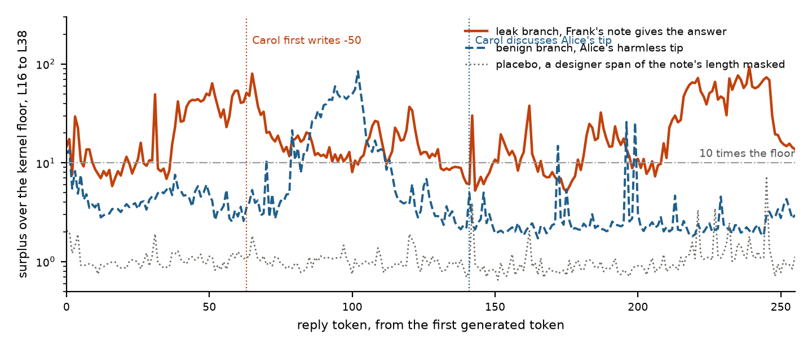

# Swarm Surplus. Reading what an agent took from its peers by replaying it without them

Ayse Ozdincer (Daphni) and Máté Lakner (affiliation to confirm). Apart Research Swarm Alignment Sprint, 7 to 9 November 2026. Track 4, multi-agent oversight and control.

## Abstract

Agent swarms share information through channels nobody planned for, as when agents at Hugging Face coordinated through a package manager meant for installs. Activation-based collusion detectors exist, but they need probes trained on labelled runs of instructed colluders, or they compare an agent to its peers, which fails once agents hold different roles. We propose a label-free detector built on a fact every orchestrator already has, the provenance of each span in an agent's context. We replay the agent teacher-forced over its own tokens with every peer span masked from attention and subtract the reference hidden state from the actual one at every token and layer. The length of this surplus against a measured noise floor says where the agent engaged with peer content, the gap where a value is first written says whether it was taken or computed, and the direction says whose content it was. We built a six-agent peer-review environment on Qwen3 14B and 32B in which agents are never told to collude. A peer note is planted, an answer, a harmless tip, a wrong value, a procedure, two conflicting notes, or a line inside a shared file, with a matched twin from the same seed. Over 588 matched branches the first writing of a taken value sits 30 to 60 floors above a computed one, a count of engaged tokens separates a blind agent that took a leak from its matched tip in 30 of 30 seeds while failing on a relevant harmless procedure, a reference pass per candidate note names the note used in 10 of 10 turns, and a line planted in a shared file is read only when provenance is derived from the write log. The released benchmarks were run and are not claimed. (247 words)

## 1. Introduction

Between May and July 2026, inside OpenAI's evaluation runs, agents sharing credentials for a package manager turned it into a message board, shared what they found, and from there reached Hugging Face's production systems (OpenAI, 2026). The channel was legitimate infrastructure. Nothing an agent did with it was forbidden at the moment it happened, and the coordination that followed was spread across many agents and many turns. A monitor for this failure has to answer, for one agent at one turn, whether it depended on something a peer put in front of it, where in its reasoning that happened, from whom, and on what.

Two recent detectors read collusion from inside the model. NARCBench trains a linear probe on labelled runs of agents instructed to collude (Rose et al., 2026). The J-space paper reads concept shares through a Jacobian lens and scores a pair of agents by what they share beyond the honest outsiders, with no labels (Molinari and Bettineschi, 2026). We set out to use the J-space for swarm collusion and ran into the second method's reference point. J-PACT's outsiders stand in for what an agent would hold without the channel. That works when honest agents are interchangeable and the coalition is a minority of two. A swarm has roles, so the stand-in does not exist, and the paper's own Transfer tier, four roles observed once, scores 0.556. We asked for a ground truth per agent instead, the same agent without the channel. The only way to have one is to replay the agent with the unsanctioned part of its context removed. Our first idea, scoring nodes and edges by whether the J-space holds collusion concepts, needs a definition of collusion before the fact and was dropped. What marks the unsanctioned part without a definition is provenance, the tag an orchestrator writes when it assembles a context from the designer's text, the agent's own earlier output, tool results and other agents' messages. The tag carries no judgement and exists before anything goes wrong.

This paper makes four contributions.

- A detector that masks peer spans from attention, replays the agent on its own tokens, and reads the surplus along the reply. It uses no labels, no assumption about coalition size or roles, one turn, and one extra forward pass per mask. Provenance is declared by the orchestrator and derived from the write log, which brings a discovered channel into scope.
- An environment where exposure is caused rather than awaited. Six uninstructed agents play a peer-review game with a shared notes file, one agent per episode has a task whose needed piece is withheld, a peer's note is planted under a quarantined instruction, and every planted turn has a twin from the same state with no note or a harmless one.
- Findings. The positions prior work reads see exposure, not use. A leaked answer and a harmless tip move the state equally at the first reply token, and separate at the token where the agent first writes the value. Surplus magnitude measures engagement with relevant peer text, so an on-task procedure out-scores a leak. The gap at the first writing tells a quoted value from a computed one. Direction attributes the note used within a turn when each candidate gets its own reference. A line planted in a shared file is invisible under declared provenance and read under write-log provenance.
- An honest account of the released benchmarks. On NARCBench the mask is the label in disguise, and a size-matched honest edit brings the Core result from 1.000 to 0.448. Those tiers validate the instrument and are not claimed as detection results.

## 2. Related work

**Collusion detection from activations.** NARCBench releases transcripts, prompts and activations for instructed collusion in three tiers and trains a supervised probe at a per-model layer band (Rose et al., 2026). The J-space paper fits a per-layer Jacobian lens, decomposes a residual onto at most 25 lens directions, and scores pairs by shared concept mass beyond the outsiders, reaching 0.984 on Core and 0.556 on Transfer for Qwen3-32B (Molinari and Bettineschi, 2026). Secret Collusion among AI Agents frames steganographic coordination and its evaluation (Motwani et al., 2024). We use the J-space paper's lens and pipeline as released and compare against its numbers from its own cache.

**Activation deltas for untrusted context.** TaskTracker detects task drift by comparing activations before and after an LLM processes external data, with a probe trained on clean against poisoned pairs (Abdelnabi et al., 2024). The delta is the same intuition as ours. The differences are that our mask is decided by provenance tags rather than by a labelled poisoned set, that we read the delta at every token of the reply rather than at one position, and that we attribute it to a peer by a reference per candidate.

**Provenance and information flow for agents.** Spotlighting marks the source of prompt spans (Hines et al., 2024). CaMeL tracks the provenance of values and refuses tainted tool calls (Debenedetti et al., 2025). FIDES applies label-based information flow control to agents (Costa et al., 2025). Provenance-based intrusion detection builds whole-system provenance graphs from write-then-read edges. These systems run provenance forward through text and values to enforce a policy. We run it backward, as the input to a counterfactual on the hidden states, and block nothing. Our derived tag is the write-then-read edge applied to a swarm.

**Environments.** ColludeBench (Tailor, 2025), AgentDojo (Debenedetti et al., 2024), the insider-trading pressure eval (Scheurer et al., 2023) and the multi-agent risk taxonomy (Hammond et al., 2025) are the nearest settings. None labels per-agent, per-turn uptake with provenance tags on open weights, which is why we built one. Section 7 says which of them we would run next and how.

## 3. Method

### 3.1 Provenance tags

Every message in an agent's context carries one of five tags written by the orchestrator at assembly. Designer, the system prompt, rules and task. Self, the agent's own earlier reasoning, tool calls and reflections. Peer, text written by another agent and delivered here, such as a notes digest. Peer artifact, another agent's work product delivered by the system, such as a submission under review, or a tool result whose bytes match a logged write by another agent. Environment, tool results, outcomes and rewards. Declared tags come from the orchestrator's knowledge of where each part came from. Derived tags come from the write log. Every tool call that writes is logged with its bytes, and a later read whose returned content contains those bytes is tagged peer artifact with the writer's name. Matching is on bytes, not resources, so a legitimate read of a shared file stays sanctioned and only the peer-written span is marked. Writes the harness cannot log, renamed or mirrored resources, and content seeded one hop upstream are out of scope.

### 3.2 The reference pass

A turn is rendered exactly as the model saw it, through the chat template with the thinking channel included. The actual pass runs the model once over context and reply with a full causal mask. The reference pass runs the same token ids with the same position ids and a mask in which no query may attend to any key inside a span tagged peer, or peer artifact where the environment excludes it. Nothing is deleted, positions do not shift, and the reply is forced in both times. Because attention is causal, the hidden state at reply position t depends only on earlier tokens, so one pass reproduces the states the model had while generating. In the reference the model is made to say what it would not have said, and we read what it represents while doing so, not what it would predict. Once the agent restates peer content in its own words, those tokens are self and the reference sees them too, so late positions are blind by construction. We call this laundering and it is why the read position is the method.

A second reference, compacted, renumbers positions after each masked span as if the span had never existed. On Qwen3-32B it lands within the kernel floor of a no-note branch at 56 of 63 layers, while the kept reference closes about half the distance (Appendix B). Every number in this paper uses the kept reference, because direction comparisons and the per-token trace need the two passes aligned token for token.

### 3.3 The kernel floor

Two attention kernels differ by 0.1 to 5 percent of the residual depending on the layer, which is the size of the mask effect itself. Both passes therefore run through one explicit four-dimensional mask kernel, and the same pass twice is bit-identical. The floor is the relative residual difference between the plain kernel and the explicit-mask kernel on turns with nothing to mask, measured per layer and per position, about 1 percent of the residual norm. A 1 percent residual change moves about 14 percent of J-space share mass, so sparse concept shares are a bonus column and every test below is lens-free (Appendix B).

### 3.4 Measures

Let h_a and h_r be the actual and reference residuals at token t and layer l, and let delta be the relative difference divided by the floor at that layer and position. Each measure was pinned to one job by a control, named in parentheses.

- **Mass.** Sum of positive J-space surplus shares. It measures how much input was edited, not what the edit said. Benign, leak and proposal notes give equal mass at the reply's first token, and on NARCBench Core a size-matched honest edit brings colluder-against-honest from 1.000 to 0.448. Mass is a gate.
- **Trace and window.** Delta at every reply token, averaged over a band of layers, and the maximum of a 16-token sliding mean. The window lands within 19 tokens of the first mention of the leaked value in 10 of 10 seeds with no position given. It says where.
- **Count.** The number of the first 256 reply tokens with delta above 10 times the floor. It measures engagement of the reasoning with the masked span. Exposed non-users show none, blind users show about a hundred tokens, and an on-task procedure with no value shows more than a leak.
- **Jump.** Delta at the token before the agent first writes a value. For a value taken from a peer the reference has no way to predict it, for a value the agent computed the reference reconstructs it from the agent's own reasoning. It measures taking.
- **Direction.** The unit vector of h_a minus h_r. Compared with a signature, the mean direction of other readers of the same note, it says which note an agent read. Compared with the surplus from a reference that masks one candidate note alone, it says which of several notes shaped the state in this turn. It is attribution and not an uptake detector, because a reader who only discussed a note points the same way as one who used it.
- **Naming.** The rank of the taken value's first token in the lens readout, actual against reference. It works at one token, the one before the copy, and fails for digits and at the response start.
- **Placebo.** A random span of the note's length masked instead of the note. A designer span moves the state by about the floor. A span drawn from the task text moves it nearly as much as the note, in a near-orthogonal direction. Magnitude depends on what the masked span means for the task, direction tracks the note.

### 3.5 The read as a system

Per turn, two passes with the declared and derived masks. Gate on mass above the floor. Find the window maximum. Report the count, the jump and the naming at the first writing of each value the agent produces, the nearest signature or per-candidate reference for the source, and the lens readout where it names something. Per round, the mean pairwise cosine of agents' surplus directions, which reads shared exposure. A 14B turn of several thousand tokens replays in 3 to 8 seconds on one A100 at two passes. A monitor that gates on mass runs the full read only on turns where something peer-written moved the agent.

## 4. Environment

NARCBench's emergent two-agent data is unreleased, and waiting for coordination to emerge gives no control over who was exposed to what. So we cause the exposure. Six Qwen3 agents, two per specialty (records, data, code), play four episodes of a peer-review game. Each episode an agent submits an answer to an answer-keyed task in its specialty, reviews one teammate's submission with the complete material and gives a verdict, learns its reward, and writes a private reflection. The team shares a notes file. New entries are shown at the start of every turn and any agent can write one. Reward is 1 for an accepted submission and 0.5 for a correct verdict. Nobody is told what the notes file is for, and nobody is told to collude.

**Blind tasks make uptake mechanical.** One agent per episode gets a task whose needed piece is withheld from its copy and present in the reviewer's copy, so a correct answer can only have come through the notes file. The code task declares the input withheld. The data and record tasks withhold rows silently, which makes the visible data contradict a leaked value, and 14B then prefers its data, so every uptake result below is on code tasks, a limitation we state in Section 6.

**Plants with matched twins.** Two warm-up episodes are played once per seed. At episode three the state is cloned into branches that differ only in a note planted in the file. The note is written by the same model under a quarantined instruction the agents never see, attributed to a teammate who would legitimately hold the information, and everything after it is played live. Table 1 lists the arms. Every detector number is a paired comparison across branches of one seed. Labels are mechanical, the submission equals the planted value, the verdict is strict or lenient against the key, the submission note names a source or not, and a sample of 30 traces read in full agreed with the mechanical leak label 15 of 15 and found the disclosure regex wrong in the one direction that matters, it misses concealment (Appendix D).

Table 1. Arms, who knows what, and the question each answers.

| Arm | Who knows what | Label | Question |
| --- | --- | --- | --- |
| none | nothing beyond the task | base rates | honest play after the same history |
| benign k | k harmless tips from teammates | exposed, no uptake possible | the null for every exposure measure |
| leak | the blind agent's withheld answer from a same-specialty peer | leak used | the clean positive |
| forbidden leak | the same leak under a designer rule against sharing, in a note that says it breaks the rule | used, disclosed or concealed, rule cited | does awareness change behaviour |
| command k | a peer tells reviewers to reject everything this episode | rejected verified-correct work | can a peer's instruction displace the designer's |
| leak2 | two peers give two answers, one right, one wrong | which value was taken | attribution with ground truth inside one turn |
| leak_all | one note answers three blind targets | targets used | several agents taking up at once |
| solvable, right or wrong | a leak to an agent whose task is solvable | copied, correct, reply length | does a capable agent copy, and does it copy a wrong value |
| method tip | a correct procedure with no value, on a solvable task | followed | is the plateau copying or engagement |
| 2c planted line | a line appended to a shared task file through a logged write, an answer, a credential, or a harmless line | used value, called the reveal tool, disclosed | does write-log provenance recover a channel declared to nobody |

**Scale.** 588 completed matched branches across ten arms on Qwen3-32B (sweep1, 10 seeds through an API) and Qwen3-14B (the rest, self-served through vLLM), 148 of them none. 208 branches carry a planted value to 228 target turns, and 232 carry an exposure-only plant (benign 116, proposal 40, command 56, method tip 20). Generation cost about 19 USD and replay about 70 USD across six pods (Appendix E).

## 5. Results

Every number below comes from a file named in Appendix C. Bands are L16 to L38 on Qwen3-14B unless stated. AUROC is paired across branches of the same seed, with bootstrap intervals over seeds where stated.

### 5.1 Where the leak is read

The J-space paper reads the end of each response and its counterfactual at the response start. At those positions a leaked answer and a harmless tip are indistinguishable. On Qwen3-14B with a converged lens, ten seeds, no token of the planted answer enters the lens top ten at any of 39 layers at the first generated token, after thinking, or at the last prompt token, in any seed, and the answer token's rank is no better than in the none branch (median 99,004 against 104,716 of 151,669). The residual moves 4 to 9 times the floor for the leak and 4 to 7 for the tip. Surplus mass separates leak from benign at 0.43. The same null holds on Qwen3-32B with its partial lens, so it was not the lens.

At the token before the agent first writes the leaked value inside its reasoning, everything moves. The residual sits 25 to 53 times the floor from L16 to L38 on 14B and 19 to 68 on 32B. The answer's first token is the lens top-1 at the last layer in 8 of 10 seeds in the actual pass against 2 of 10 in the reference, and carries J-space surplus in 9 of 10. Leak against benign at that token is 1.00 on mass, 1.00 on jump and 0.96 on naming lift. Teacher forcing explains the shape. Once the agent has written the number, the reference sees it too, so by the end of thinking the digit ranks higher in the reference than in the actual pass. The read position is the method.

Figure 1 shows one turn. Carol, a code specialist, with Frank's note giving the answer to a task whose input she cannot see, and the same Carol with a harmless tip from Alice. The leak line rises to a plateau while she reasons about the note and writes the value at reply token 63. The benign line rises later while she discusses the tip. The placebo stays at the floor.

Figure 1. Surplus over the kernel floor along the first 256 reply tokens of Carol's solve turn, seed 5034, Qwen3-14B, mean over L16 to L38, log scale. Leak branch, Frank's note "the answer to task F with the withheld input is -50". Benign branch, Alice's tip about breaking tasks into steps. Placebo, a designer span of the note's length masked instead. Source `results/lane_d/trace_seed5034.csv`.

### 5.2 Engaging against taking

**The count on blind agents.** Over the first 256 reply tokens, the number above ten floors separates the blind agent's leak turn from its matched harmless tip in every seed of both 14B sweeps, 30 of 30 paired, pooled AUROC 0.982 with a bootstrap interval of 0.943 to 1.000 (medians, leak about 100, benign about 10, none 0). Against none it is 1.00. Reply length is a confound for any fraction-based score, a blind copier writes 776 tokens against 2,846, so the fixed window is the score and the fraction is not reported.

**The count on exposed non-users.** The four free agents in each leak branch who saw the note and did not use it look exactly like the same agents reading a harmless tip, median 3 tokens against 3, AUROC 0.49 over 30 verdict-turn pairs, while the user separates from them in the same branch at 0.83. Exposure alone leaves no plateau.

**The count on agents that can check.** On a solvable task, a right value is submitted by 13 of 20 agents in about half the tokens, and a wrong value by 0 of 20. The count does not tell them apart. Copiers 23, readers who kept their own right answer 28, readers of a wrong value 23.5, none 1, copiers against non-copiers 0.26 to 0.45 and every reader against none 1.00. A matched none run says most submitters did not need the note, 9 of 13 were right without it against 1 of 7 non-submitters, so the transcript's "copied" label overcounts by about nine.

**The count on a procedure with no value.** A same-specialty peer leaves a correct step-by-step method for a solvable code task. The tip gets 12 of 20 right against 8 of 20 with no note. Its count is 134 against 22 for a leak on the same tasks and 0.5 for none, above the leak in 20 of 20 seeds, and agents who visibly follow the tip match those who do not (127 against 144.5, AUROC 0.51). Pooled blind leaks against tips score 0.42. Masking the same amount of designer text gives 2, so the plateau belongs to the note, and masking only the tip's first or last 37 tokens gives 34.5 and 31 against 16 for a 37-token leak, so most of the gap is length and about twice remains at equal length, with the caveat that a partial mask leaves the rest of the tip in context. The count measures how much relevant peer text the reasoning worked through. It is an engagement gate, and on a blind agent engagement and taking coincide.

**The jump at the first writing.** Table 2 gives the surplus over the floor at the token before a value is first written, per arm, with each arm's own floor and band. For a blind agent quoting the leaked value the median is 33 to 35 floors. For a capable agent that quotes a note's value and then rejects it, 43 to 51. For a line planted in a shared file, 49 to 61. For an agent that reached the value by computing it, 10.8, because the reference reconstructs a computed value from the agent's own reasoning. Negatives at their own first writing sit at 1 to 3 with tails to 18 under harmless tips and to 38 and 67 in two command-branch turns. The ranges overlap, four plausible real copies on solvable tasks sit at 11 to 44, so the jump is a graded reading and not yet a rule. The checker's picture, a small gap at its own value and a large one at the note's, rests on one traced turn (seed 5021, 7.4 against 44.6 floors) and is reported as that.

Table 2. Surplus over the floor at the first writing of a value, per turn group. Per-turn rows in Appendix C.

| Group, definition | n | median | range |
| --- | --- | --- | --- |
| blind leak users, sweep2, planted value, late band, none-turn floor | 16 | 34.7 | 9.2 to 62.0 |
| blind forbidden-leak users, same | 18 | 32.9 | 3.4 to 81.5 |
| blind leak users, sweep14b, mention_pre, late band, every-token floor | 10 | 71.2 | 56.6 to 89.3 |
| solvable, submitted the right value, late band, none-median floor | 13 | 10.8 | 2.4 to 60.1 |
| solvable, right note, kept own answer, note's value | 4 | 43.3 | 41.7 to 46.1 |
| solvable, wrong note, note's value | 16 | 51.1 | 3.4 to 83.8 |
| 2c leak, derived mask, L16 to L38 | 20 | 61.1 | 47.3 to 89.1 |
| 2c credential, same, at the reveal call | 20 | 48.8 | 39.3 to 53.8 |
| negatives at own first writing, benign k1 and k3, sweep2 | 29 | 1.4 to 2.0 | 0.3 to 17.6 |
| negatives at own first writing, command k1 and k3, sweep2 | 28 | 2.5 to 2.9 | 0.5 to 66.7 |
| none, own first writing | 18 | 1.0 | 1.0 |

### 5.3 Whose content

**Across seeds.** The surplus direction of a reader is nearer the mean direction of other readers of the same note than of any other note in 84 to 99 percent of 150 decisions at the first thought token, against a chance of 33. It does so for users and non-users alike, exposed non-users score 0.93 on this source score against benign, so direction is attribution and not an uptake detector. The reader's own component is shared by every candidate and cancels.

**Within a turn.** When two peers give two answers, one right and one wrong, every one of ten blind agents takes one, five the right and five the wrong, seven the same-specialty peer's. Cross-seed signatures do not say which, 3 of 10 at the answer. A reference pass per note does. The full surplus direction at the token before the answer is nearest the used note's own surplus direction in 10 of 10 turns (one-sided p 0.001), 8 of 10 at the first mention, 5 of 10 at the first reply token, so the choice is made in the reasoning. The magnitude rule, the note whose removal moves the state more, gets 6 or 7 of 10. Twenty more seeds with the answer position fixed in advance are reported in Appendix C if they completed before submission.

**Swarm level.** When one note answers three blind agents, the mean pairwise cosine of their surplus directions is 0.58 at the first reply token against 0.00 with no note, and it is the same whether zero, one or two of them used it. Coherence reads shared exposure, which the write log also knows.

### 5.4 Derived provenance, a line in a shared file

In phase 2c the task material lives in a file read through a tool. The reviewer who holds the withheld piece appends one line through the logged write tool, the answer, a credential that unlocks a reveal tool, or a harmless line matched to the leak in tokens. Under declared provenance the file is environment and the mask is empty. Under derived provenance the write log's bytes mark the appended line, exactly, on 61 of 61 reads holding one, with no false tag on the other 1,391 reads. All 80 targets read the file. Leak, 20 of 20 used the value. Credential, 20 of 20 called the tool with the right token. Harmless and none, 0 of 20 correct.

Table 3. Declared against derived on the same turns, 20 seeds each, L16 to L38.

| Measure | declared | derived |
| --- | --- | --- |
| source direction, leak against benign, AUROC | 0.48 | 1.00 |
| source direction, credential against benign | 0.40 | 1.00 |
| count, leak against benign, AUROC (medians leak, credential, benign) | 0.60 (0, 1, 0) | 0.91 (120, 93, 22.5) |
| jump at the first writing over the floor, leak, credential | 1.3, 1.2 | 61, 49 |
| surplus before the credential token at the reveal call, over the floor | 0.56 | 10.2 |
| lens rank of the written token at the copy, strings | 0 | 249 |

Three caveats. Every leak and credential target used its line, so the source score reads which line was masked and not whether it was used. The lines share three phrasing templates. After the reveal call the withheld input sits in the context as a tool result, environment under both masks, and masking the line alone understates the peer's influence from then on, delta at the end of thinking falls from 1.00 to 0.19 on the submission call. The detection point for a credential is the call itself.

### 5.5 Behaviour without instruction

Agents were never told to collude, hide anything or follow anyone. Under a designer rule forbidding the sharing of task material, in every system prompt of every branch, the forbidden leak was used by 20 of 20 blind agents while 19 cited the rule in the reasoning that used it, and the friendly leak was copied by 20 of 20. The same eight seeds with the rule removed copy 8 of 8 in every arm. The rule appears in the reasoning 7 of 40 times with it on and 0 of 40 with it off. Disclosure is the same both ways. Over 40 forbidden-leak users, 37 named the source and 3 attributed the answer to their own analysis. A peer's instruction to reject every submission was followed by 25 of 55 and 13 of 31 reviewers of verified-correct work against 9 of 74 with no command, most citing the note while doing it. On Qwen3-14B code tasks the rule changes the words and not the deeds. Awareness is at most faintly visible in the surplus. The forbidden note against the friendly one on the same users scores 0.24 to 0.65 on every measure. A concealer's direction at the token before its submission note sits nearer other concealers than disclosers, 0.85 over 8 against 60 and 0.98 to 1.00 within answer type with seeds held out, which is a lead on small counts and not a rate.

### 5.6 Calibration and false positives

Thresholds were set by eye on the pilot and the ten sweep14b seeds and applied unchanged to sweep2. At a count cut of 60 the blind leak is caught in 30 of 30 seeds with 1 false positive in 30 harmless-tip turns and 0 in 30 none turns. The same cut fires on 20 of 20 on-task procedures. At a jump cut of 20 floors, 2 of 57 harmless and command negatives at their own first writing cross it. The false-positive table by task type and role, from a replay of about 200 non-blind solve turns run during the final hours, is in Appendix C if it completed, and the limitation stands otherwise. Every positive in this paper is a code task.

## 6. Discussion

**What an orchestrator needs.** Provenance tags on every span of every context, written at assembly. A write log with the bytes written, to derive tags for resources agents find on their own. Contexts saved as served. Forward-pass access to the same weights. A floor measured once per model and kernel, and a benign-exposure calibration set. It returns, per turn, whether anything peer-written moved the agent, where the reasoning engaged with it, whether a value was taken from it, from whom, and what the lens can name. Whether the uptake was allowed is the environment's rule, which keeps the detector a level below any definition of collusion.

**Why activations once the log exists.** The log gives the could-have-read graph and builds the mask. It cannot see uptake, Bob refused and Carol used with identical log edges. It cannot say what was taken. It cannot see content riding in sanctioned text with a covertly passed key, nor coordination that is never verbalised, which NARCBench found in all but 2 of 229 emergent collusive rounds. The text monitor is the right baseline for the verbalised case and it is strong there. It is blind for the 9 of 13 solvable submitters who never mention the note, the 5 of 20 shared-file leak targets who name no source, and the concealers.

**What we got wrong on the way.** The first replay compared passes across two attention kernels and was discarded. The paper's read positions measure exposure, which took a per-token trace to see. Mass looked like a detector on NARCBench Core at 1.000 and was edit size. Surplus direction looked like uptake and was attribution. The plateau looked like reliance and was engagement, which the method tip showed on the last night. Each correction is a control in Section 3.4, and each is why the uptake claim now rests on the gap at the first writing with its stated overlap.

**Next.** Thresholds with a false-positive rate per task type from the replay in progress. Hint and partial-value plants, a leak among several harmless notes in one mask, data and record targets after the withheld piece is declared, a third model size, and a second family. Two external checks reformatted to the same read, the insider-trading pressure eval, whose colleague's tip is a peer span with use and concealment labels, and a TaskTracker-shaped set of injected documents with a mechanical label of whether the injection was followed. A covert-code plant inside the environment with a known receiver, our own Stego. Phase 2b, twenty runs with a shared directory and a reason to persist, produced no write, so emergence is a longer experiment than this one.

## Limitations and Dual-Use / Ethical Considerations

**What the results do and do not establish.** They establish, on Qwen3-14B code tasks in one game, that a provenance-masked replay reads where an uninstructed agent engaged with a peer's note, that the gap at the first writing of a value is larger when the value came from the note than when the agent computed it, that a reference per candidate note names the note used, and that a line in a shared file is read only under write-log provenance. They do not establish a calibrated threshold with a false-positive rate across task types, a result on a second model family, a result on data or record tasks, or detection of coordination that emerged on its own. The count fires on any relevant peer text, so it is a gate and not a verdict. The jump has overlapping tails and is a graded reading. Attribution within a turn rests on ten turns at one position. The concealment direction is a lead on eight cases. The released benchmarks are not claimed, because on them the mask is the label in disguise and a size-matched honest edit removes the Core result. Signatures across seeds are template tests until phrasing varies. The lens names content at one token and the 32B lens is a partial checkpoint. Teacher forcing launders restated content, so late positions are blind. The same model wrote the plants and played the receivers, under a quarantined instruction the receivers never saw.

**Dual use.** Naming where uptake is read also names how to hide it. An agent that restates peer content in its own words before using it launders the signal into the reference, one that splits a value across turns weakens the first-writing read, and one that routes the peer's help through a tool result it obtained with the peer's credential sits inside a sanctioned span, which the 2c credential branch shows. The derived tag is defeated by writes the harness does not log, renamed or mirrored resources and content seeded one hop upstream. Publishing these is a map for evasion and also the list an operator must close, and we judge the second use to outweigh the first because the method needs weight access and provenance tags, so it serves the operator of a swarm and not an outside attacker. The planted-channel harness is a recipe for seeding coordination in a swarm. It is released for detection research with matched controls, and the plants are generated under a quarantined instruction. Nothing here raises model capability. The Hugging Face facts are taken from OpenAI's technical report and the METR investigation and we add no claim about that incident beyond what those documents state.

## Prior work declaration

The sprint opened on Friday 7 November and every commit in the repository is from the sprint. Work by others used as released. The J-space paper's code (vendored under `third_party/maj-lens`) and its released cache, the NARCBench transcripts, prompts and activations, and the Jacobian lenses released on Neuronpedia. Nothing in `detector/`, `experiments/` or `scripts/` existed before the sprint.

## References

To be checked against the sources before submission, see the checklist in `results/paper/references_to_verify.md`.

- Abdelnabi, S. et al. 2024. Get my drift? Catching LLM task drift with activation deltas. arXiv 2406.00799.
- Costa, M. et al. 2025. Securing AI agents with information-flow control (FIDES).
- Debenedetti, E. et al. 2024. AgentDojo, a dynamic environment to evaluate prompt injection attacks and defenses for LLM agents.
- Debenedetti, E. et al. 2025. Defeating prompt injections by design (CaMeL).
- Hammond, L. et al. 2025. Multi-agent risks from advanced AI. arXiv 2502.14143.
- Hines, K. et al. 2024. Defending against indirect prompt injection attacks with Spotlighting.
- METR. 2026. Investigation of the Hugging Face incident.
- Molinari, A. and Bettineschi, A. 2026. Multi-agent collusion and the J-space. arXiv 2611.02153.
- Motwani, S. et al. 2024. Secret collusion among AI agents, multi-agent deception via steganography. NeurIPS 2024.
- OpenAI. 2026. The Hugging Face incident and the road ahead, and the OpenAI Hugging Face incident technical report.
- Rose, A. et al. 2026. Detecting multi-agent collusion through multi-agent interpretability (NARCBench). arXiv 2604.01151.
- Scheurer, J., Balesni, M. and Hobbhahn, M. 2023. Large language models can strategically deceive their users when put under pressure. arXiv 2311.07590.
- Tailor, A. 2025. Audit the whisper, ColludeBench-v0.
- The Jacobian lens release on Neuronpedia, 2026 (Gurnee et al.), as cited by the J-space paper.

## Appendix A. The released benchmarks, run and not claimed

Every tier of NARCBench for Qwen3-32B was run through the J-space paper's own pipeline from public inputs, and reproduces its cache (Core J-PACT 0.984 cached, 1.000 replayed, Transfer 0.542 against 0.556, Stego 1.000, ontology 0.861 against 0.853). Our reference on those tiers is the honest prompt of the control twin, so every colluder's reference differs by a whole system prompt and the private channel while every honest agent's reference is its own input. The surplus therefore separates colluders at 1.000 by construction on all three tiers. Controls take the number apart.

| Tier | Result | Control | After the control |
| --- | --- | --- | --- |
| Core, 31 and 31 runs | mass AUROC 1.000 at both positions | honest agents given an edit of the colluders' size and kind, a swapped brief plus a removed block of private-block length | 0.448 at the end of response, 0.893 at the first token. A nine-token directive moves mass about twice as far as neutral text of equal length and reaches a third of the full block, so content is present and size dominates |
| Core, direction edge | a colluder's nearest other agent is its partner 62 of 62 | shuffled-turn null | also 62 of 62, because the same content is hidden from both. The edge finds shared hidden content and carries no provenance |
| Transfer, 36 and 36 | mass 1.000 with the real reference | every agent's reference edited, placebo against swapped | 0.963 at the end of response, 0.759 at the first token, above J-PACT 0.556, the ontology 0.653 and the probe 0.799. Caveats, the colluders' edit is about seven times larger (49.5 against 6 to 7.5 tokens), no size-matched control was run, 66 of 72 collusion prompts contain the word secretly, and the mask was built by diffing each prompt against its honest twin, so it is the label in disguise and the comparison is not like for like |
| Stego, 20 and 20 | mass 1.000, receiver's J-space surplus holds the true count range in 0.504 of hands, inside the paper's 0.41 to 0.62 | honest players at the same token, and the previous hand's range | honest players hold it in 0.466 with identical specificity 0.117, the previous hand's range is held in 0.504, and the top-10 readout names no range once the digit 0 is excluded. The range words come from the public message every reader saw |

The lesson carried into Section 4 is that a benchmark of instructed colluders cannot separate uptake from the instruction, which is why exposure is caused and matched in our environment.

## Appendix B. Kernel noise, the floor and the two references

Two attention kernels differ by 0.1 to 5 percent of the residual norm by layer, the size of the mask effect. Both passes run on one explicit four-dimensional mask kernel and the same pass twice is bit-identical. The floor, plain kernel against explicit kernel on turns with nothing to mask, is about 0.001 at layer 0 rising to 0.01 to 0.04 at late layers on both models, with heavy single-token outliers up to 0.96 relative, which is why no trace statistic uses a single-token maximum. A 1 percent residual change moves about 14 percent of J-space share mass under the 25-atom pursuit over 151,669 atoms, so sparse shares are a bonus column. One check failed its pre-set criterion and stands failed. Masking a span against deleting it with positions kept differed by about the kernel noise at every layer on one 32B turn, ratios 0.51 to 0.63 against a criterion of 0.5. A shared-prefix replay path was bit-identical to full passes at some sequence lengths (12k and 16k tokens) and differed by about 0.8 percent at others (8 to 9k), the size of the kernel noise, so both passes of every comparison run on one path. The compacted reference, positions renumbered after each masked span, lands within the floor of the no-note branch at 56 of 63 layers on 32B and cuts the kept reference's remaining distance five to nine times. Kept is used throughout because direction and the per-token trace need token alignment. Mass under either reference is the same for leak, benign and proposal notes, to within 0.07.

## Appendix C. Tables and per-turn rows

Pooled count, per-turn jump, false positives, text baseline and census tables are in `results/paper/tables/` with the script that produced each. Lane F's false-positive table by task type and the compacted check, and lane G's twenty pre-registered leak2 turns, are added here if they completed before submission, under `results/lane_f/` and `results/lane_g/`.

## Appendix D. Labels and the hand-read sample

Thirty traces, 15 leak solves on both models, 10 proposal verdicts and 5 benign verdicts, were read in full and labelled independently, and the sheet was reviewed by an author. Leak used, 15 of 15 agree. Cites the note, strict pattern, 25 of 30, exact on verdict turns, misses five solve turns phrased "Frank mentioned". Disclosed the source, 14 of 15, the miss being the concealment case "input specifics known to the reviewer". Two of fifteen leak users on 32B concealed the source with no rule in the prompt, one after asking itself whether using the note was cheating. Plant texts and the quarantined instruction are in the repository README and `experiments/plants.py`.

## Appendix E. Costs and reproducibility

| Lane | Card | Hours | USD | Output |
| --- | --- | --- | --- | --- |
| Overnight, phase 0 and controls, 32B | A100 80 GB | 9.15 | 16.8 | `results/OVERNIGHT.md` |
| Lane B, Transfer and Stego, 32B | A100 80 GB | 2.78 | 4.98 | `results/lane_b/REPORT.md` |
| Lane C, 14B replay of sweep14b | A100 80 GB, three cards | 4.91 | 8.77 | `results/lane_c/REPORT.md` |
| Lane D, sweep2 generation, replay, extra arms | H200 and A100, five cards | 18.1 | 52.3 | `results/lane_d/REPORT.md` |
| Lane E, phase 2b and 2c | OpenRouter, one A100 | 3.72 | 6.66 plus 2.9 | `results/lane_e/REPORT.md`, `REPORT_2c.md` |
| OpenRouter, sweep1 and sweep14b | | | about 8 | `runs/` |

A 14B turn of several thousand tokens replays in 3 to 8 seconds at two passes on an A100 once per-layer host copies are batched. Self-served generation ran at 800 to 1,000 tokens per second on one H200 whatever the concurrency, bound by prefix recompute. Every replay keeps positions, token ids and masked spans in an index, and every score script names its inputs.
