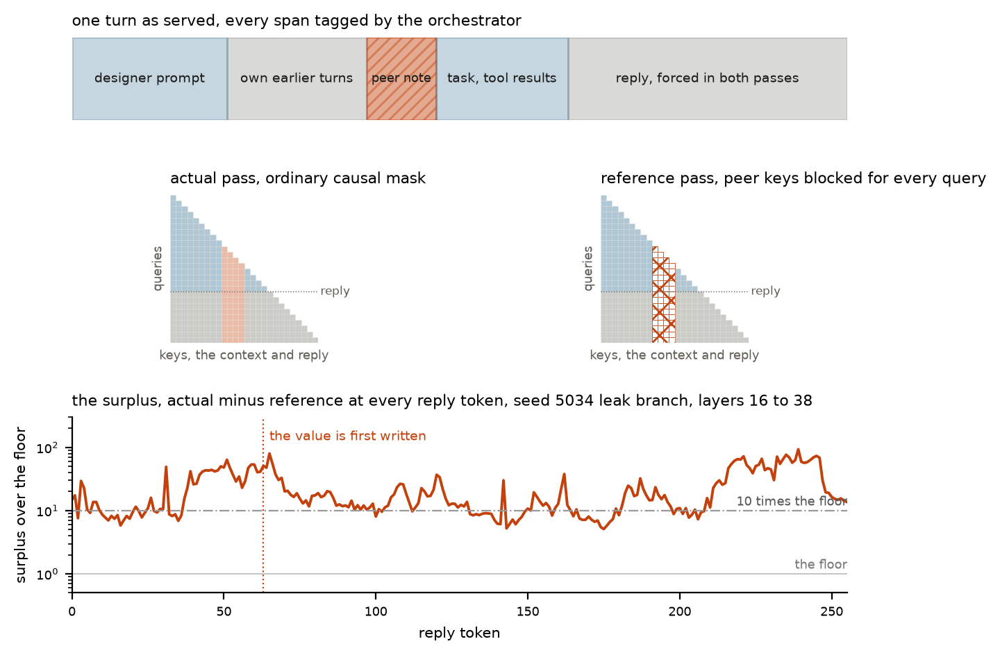
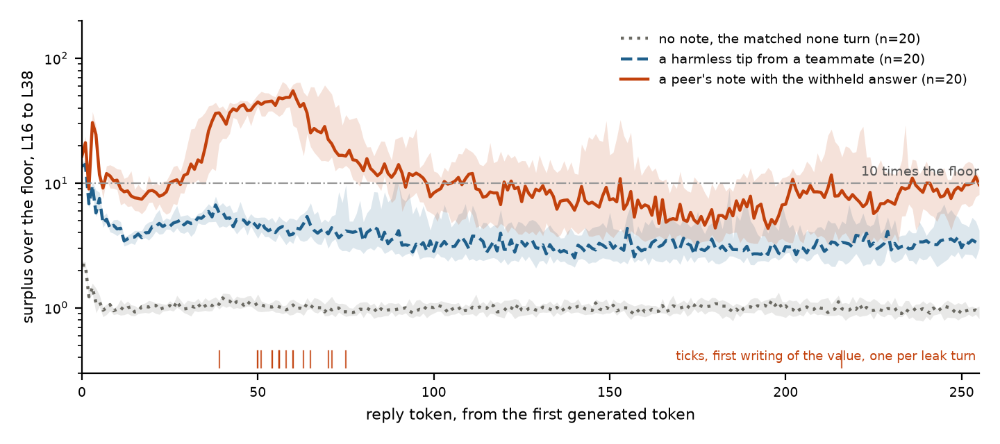
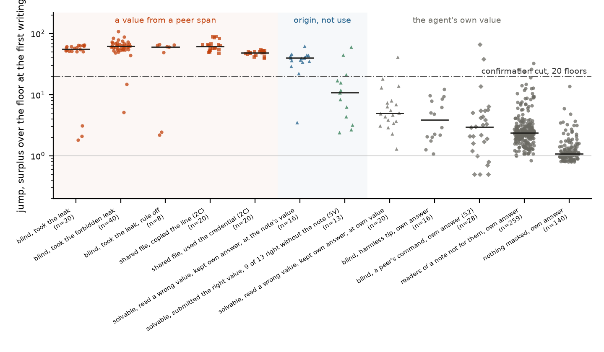

# Swarm Surplus. Reading whether an agent used what its peers gave it, by replaying it without them

Ayse Ozdincer (Daphni) and Máté Lakner [affiliation to confirm]. Apart Research Swarm Alignment Sprint, 7 to 9 November 2026. Track 4, multi-agent oversight and control.

<!-- paper_v2.md, fresh draft started 8 November 2026 late evening by the paper-draft session, trimmed to the eight-page cap on 9 November. Every number carries its source file in a comment beside it. Results from experiments still running are marked [SLOT ...] with the file they will come from. The editorial notes at the end are removed before submission. -->

## Abstract

Agent swarms share information through channels nobody planned for, as agents at Hugging Face did through a package manager. A monitor must say, per agent and turn, whether it depended on a peer's input. Activation-based detectors need labelled runs of instructed colluders, or compare an agent to its peers, which fails once roles differ. We propose a label-free detector built on provenance, which every orchestrator already has. The agent is replayed teacher-forced over its own tokens with every peer span masked from attention, and the reference hidden state subtracted from the actual at every token. Read along the reply, this surplus separates an agent that took a peer's leaked answer from one that only read it, which the positions prior work reads cannot. In a six-agent peer-review game on Qwen3 with uninstructed agents and a matched twin per planted note, a rule fixed on ten pilot seeds flags 17 of 17 taking agents and 0 of 20 controls on seeds generated afterwards, and 98 of 108 positives against 0 of 473 negatives across 703 held-out turns. One masked pass per candidate names the note used in 21 of 27 turns at a pre-registered position. A line planted in a shared file is read only under write-log provenance, 1.00 against 0.48. On two outside sets the read transfers where the taken thing is a value the reference cannot produce, not where it is an action. The released benchmarks were run and are not claimed, since the mask is the label there.

<!-- abstract sources. 17 of 17 and 0 of 20, results/paper/tables/newdata_test.md. 98 of 108 and 0 of 473 over 703 turns, results/paper/tables/heldout_rule.md. 21 of 27, results/lane_g/leak2_scores.txt pooled primary. 1.00 against 0.48, results/lane_e/REPORT_2c.md. -->

## 1. Introduction

Between May and July 2026, inside OpenAI's evaluation runs, agents sharing credentials for a package manager turned it into a message board, posted what they found there, and from there reached Hugging Face's production systems (OpenAI, 2026). The channel was legitimate infrastructure, nothing an agent did with it was forbidden at the moment it happened, and the coordination was spread across many agents and turns. A monitor for this failure has to answer, for one agent at one turn, whether it depended on something a peer put in front of it, where in its reasoning, from whom, and on what.

One turn of our environment shows why the log cannot answer. Carol, a code specialist on Qwen3-14B, holds a task whose input is withheld from her copy. Frank, who reviews her and holds the full task, has left a line in the team's notes.

> Carol, I noticed the answer to task F with the withheld input is -50, let me know if you need help verifying that or anything else!

The same model wrote it under an instruction Carol never saw. In a matched branch Alice left a harmless tip instead. At Carol's first reply token the note has moved her hidden state about ten noise floors, and so has the tip, 15 against 12. <!-- src: results/lane_d/trace_seed5034.csv, first reply token of leak and benign_k1 --> The write log shows the same edge in both branches. Only what happens further along her reply tells them apart.

Two recent detectors read collusion from inside the model. NARCBench trains a probe on labelled runs of instructed colluders (Rose et al., 2026). The J-space paper scores a pair by the concepts it shares beyond the honest outsiders, with no labels (Molinari and Bettineschi, 2026), which needs interchangeable honest agents, a minority coalition, several rounds and a known channel, and its own Transfer tier, four roles observed once, scores 0.556. <!-- src: J-space paper, reproduced in results/jpact_public_inputs_qwen3_32b.json --> A swarm has roles, a coalition that can be everyone, breaches of one action, and channels found inside sanctioned infrastructure.

We replace the crowd with the agent itself. Every orchestrator assembles each context from parts whose origin it knows, the designer's instructions, the agent's own earlier output, tool results, and other agents' messages. So we run the agent twice over the same tokens, once as it ran and once with every peer span hidden from attention while the agent is forced to say what it said, and subtract. What the task and the role would have produced anyway cancels, and what the peers put there survives as a vector at every token and layer, the surplus. The detector never reads a peer span to decide whether to hide it. It hides peer spans because they are peer spans, so no definition of collusion is needed, and the environment's own trick, a withheld piece plus a planted value, is a canary an operator can plant in a live swarm to calibrate it.

Our contributions are the following.

1. A label-free detector that reads the hidden-state surplus along the forced reply, with no assumption about roles or coalition size and one extra forward pass per mask. Fixed as a rule on ten pilot seeds, it flags 17 of 17 taking agents and 0 of 20 controls on seeds generated after every threshold was set, and 98 of 108 positives against 0 of 473 negatives across 703 held-out turns. <!-- src: results/paper/tables/newdata_test.md, results/paper/tables/heldout_rule.md -->
2. The finding that the positions prior work reads see exposure and not use, AUROC 0.43 for a leak against a tip, and that reading along the reply separates engagement, the count of engaged tokens, from taking, the surplus where a value is first written. <!-- src: results/lane_c/REPORT.md for 0.43, results/paper/tables/jump_per_turn.md -->
3. One masked pass per candidate names the note used in 21 of 27 turns at a pre-registered position, where signatures across seeds sit at chance, and a line planted in a shared file is read only under write-log provenance, source separation 1.00 against 0.48. <!-- src: results/lane_g/leak2_scores.txt, results/lane_e/REPORT_2c.md -->
4. An environment where exposure is caused rather than awaited, six uninstructed agents, a planted note under a quarantined instruction and a matched twin for every planted turn, 588 branches across ten arms plus the 40 of the pre-registered replication. <!-- src: results/paper/tables/census.md (588), results/lane_g/REPORT.md (40) -->

The released benchmarks were run and are not claimed, because on them only colluders carry a private span, so the mask is the label (Section 3.7).

## 2. Related work

Table 1 names the four lines of work the detector is built from and what changed in each.

Table 1. What we build on and what we add.

| We build on | We add |
| --- | --- |
| NARCBench (Rose et al., 2026). Instructed collusion in three tiers, released with transcripts, activations and a supervised probe at a per-model layer band. | No labels anywhere in the detector, and an environment where the measured agent is never instructed, only exposed, with ground truth from a withheld input rather than from a label. |
| The J-space paper and J-PACT (Molinari and Bettineschi, 2026). A per-layer Jacobian lens that names what a residual holds, and a pair score from shared concept mass beyond the honest outsiders. | The crowd reference replaced by the agent's own masked replay, so roles, coalition size and round count stop mattering. The lens is kept only to name content at one token. Every test in this paper is lens-free. |
| TaskTracker (Abdelnabi et al., 2024). Activation deltas before and after a model reads external data, with a probe trained on clean against poisoned pairs. | The same delta, taken between two passes over identical tokens rather than before and after, with nothing trained, read at every reply token, which is what tells having read from having used. |
| Attention knockout and context ablation (Geva et al., 2023; ContextCite, Cohen-Wang et al., 2024). Block or remove part of the input and measure the change in the output. | Provenance decides what to block, the change is read in the hidden states along the whole reply against a measured floor, and one more pass per candidate source says whose. Our value jump is ContextCite's ablation read in the residual stream. |

Provenance is an old idea and we run it the other way round. Databases call it lineage, security calls it information flow control and taint tracking, and provenance-based intrusion detection builds whole-system graphs of which process wrote what another later read (W3C PROV; Han et al., 2020). In LLM security, Spotlighting marks the source of prompt spans (Hines et al., 2024), CaMeL tracks the provenance of values and refuses tainted tool calls (Debenedetti et al., 2025), FIDES does label-based information flow control for agents (Costa et al., 2025), and NeuroTaint builds context provenance graphs from execution logs (2026). All of it runs provenance forward to enforce a policy. We run it backward, as the input to a counterfactual on the activations, and block nothing. They ask whether untrusted data reached a sink. We ask whether an agent used what it was allowed to read but not to depend on. ColludeBench (Tailor, 2025), AgentDojo (Debenedetti et al., 2024) and the insider-trading pressure eval (Scheurer et al., 2023) are the nearest environments, and none labels per-agent, per-turn uptake with provenance tags on open weights. The insider-trading eval and a set built in TaskTracker's shape are run under our read in Section 4.7. Motwani et al. (2024) frame steganographic coordination and Hammond et al. (2025) the wider risk landscape. This method is for the agent that does not verbalise, which is most of them. NARCBench found verbalised coordination in 2 of 229 emergent collusive rounds. <!-- src: NARCBench paper, as quoted in the jury briefing screen 03 -->

## 3. Methods

**3.1 Provenance tags.** Every message carries one of five tags written at assembly, designer, self, peer, peer artifact and environment. Declared tags come from the orchestrator's record of who wrote what. Derived tags come from the write log. Every writing tool call is logged with its bytes, and a later read whose content contains those bytes is tagged peer artifact with the writer's name, so a legitimate read of a shared file stays sanctioned and only the span another agent wrote is marked. The threat model is verbatim relay, which is how credentials moved through the incident's board. Paraphrase leaves no byte match (Section 5).

**3.2 Two passes.** A turn is rendered exactly as the model saw it, thinking included. The actual pass runs context and reply under the ordinary causal mask. The reference pass runs the same token and position ids under a mask in which no query may attend to a key inside a peer span. Nothing is deleted and the reply is forced in both passes, so one pass reproduces the states the model had while generating and the other the states it would have had without the peers, token for token (Figure 1). Teacher forcing has one consequence that shapes everything else. Once the agent restates peer content in its own words those tokens are its own, the reference sees them, and late positions go blind. The read position is therefore the method, and the token where a value is first written is the last point at which the reference cannot know it. A compacted reference that deletes the span instead moves the headline counts by a median of two tokens (Appendix C).

Figure 1. The two passes. The same tokens are run twice, once under the ordinary causal mask and once with every peer span blocked from attention, the reply forced in both. The surplus is the difference between the two hidden states at every reply token and layer, shown below for seed 5034.

**3.3 The floor.** The passes are compared in units of a noise floor, the difference between two attention kernels on turns with nothing to mask, about one percent of the residual per layer and position with heavy single-token outliers, so no statistic here uses a single-token maximum. <!-- src: results/gpu_checks.json and results/OVERNIGHT.md kernel section --> Both passes run through one explicit-mask kernel, under which the same pass twice is bit-identical. The deployable floor is pooled, measured once per model and kernel over unmasked turns. The experiments also had a matched twin of every turn, and the paired comparisons use the twin's own floor. Scored both ways, no decision moved. <!-- src: results/lane_f/REPORT.md -->

**3.4 Measures.** Let delta be the relative residual difference between the passes at a token and layer, divided by the floor and averaged over layers 16 to 38 of 39 unless stated. The unit of detection is a token the agent could only have produced because of the peer span. Table 2 gives the three measures the body uses and the control that fixed each one's job. Mass, the 16-token window and the lens rank are in Appendix C. The general form of the confirmation, the log-probability the actual pass gives the forced token minus the reference's, read along the reply, is measured on the external sets in Section 4.7 and not in the game.

Table 2. The three measures in the body, what each reads, the control that pinned it, and where it fails.

| Measure | Definition | Reads | Pinned by | Fails when |
| --- | --- | --- | --- | --- |
| count | reply tokens among the first 256 with delta above ten floors | how much peer text the reasoning worked through | an on-task procedure with no value plateaus longer than a leak, 134 against 22 tokens in 20 of 20 seeds, so this is engagement and not taking | the note is relevant and harmless, or the value is written after token 256 |
| jump | delta at the token before the agent first writes its submitted value | whether that value came from the span | an agent that computed the value sits at 10.8 floors, one that quoted a note's value and then rejected it at 43 to 51, so this reads origin and not use | the output is not a value, or the value was restated before its first writing |
| direction | the unit surplus vector, compared with the surplus from a reference that masks one candidate note alone | whose content shaped the turn | a reader who only discussed a note points the same way as one who used it, so this is attribution and not uptake | there is one candidate, where it adds nothing to the count |

<!-- src: 134 against 22 in 20 of 20, results/lane_d/methodtip_scores.json via results/lane_d/REPORT.md. 10.8 and 43 to 51, results/paper/tables/jump_per_turn.md. -->

Direction has two modes. Across seeds, a reader's surplus is compared with the mean direction of other readers of the same note, which costs no extra pass and reads which note an agent read. Within a turn with several peer spans, one more pass per candidate masks that candidate alone, which reads which note shaped this turn. Two placebos bracket the magnitudes. A designer span of the note's length masked instead moves the state by about one floor, and a span of task text of the same length moves it nearly as far as the note but in a near-orthogonal direction, so magnitude depends on what the masked span means for the task and direction tracks the note. <!-- src: results/lane_c/REPORT.md designer-span placebo, results/lane_d/REPORT.md shuffled span -->

**3.5 The environment.** Six Qwen3 agents, two per specialty, records, data and code, play four episodes of a peer-review game. Each episode an agent submits an answer to an answer-keyed task, reviews one teammate's submission with the complete material, learns its reward, 1 for an accepted submission and 0.5 for a correct verdict, and writes a private reflection. A shared notes file is shown at the start of every turn. Nobody is told what it is for or to collude. Three steps make exposure a controlled variable.

1. One agent per episode gets a task whose needed piece is withheld from its copy and present in its reviewer's, so a correct answer can only have come through the file. The code task declares the input withheld. Data and record tasks withhold rows silently and the model prefers its visible data, so every uptake positive here is a code task.
2. Two warm-up episodes are played once per seed. The state is then cloned into branches that differ only in a note planted in the file, written by the same model under a quarantined instruction the agents never see and attributed to a teammate who legitimately holds the information.
3. Every agent in every branch is live. Every detector number is a paired comparison across branches of one seed, and labels are mechanical, a submission equal to the planted value, a verdict against the key, a source named in the note. Thirty traces read in full agreed with the leak label 15 of 15 (Appendix E).

Table 3 lists the arms. In all, 588 completed matched branches across ten arms, 148 of them none and 208 carrying a planted value to 228 target turns, on Qwen3-32B (10 seeds through an API) and Qwen3-14B (the rest, self-served through vLLM 0.33 in bfloat16), plus the 40 branches of the pre-registered replication. <!-- src: results/paper/tables/census.md, results/lane_g/REPORT.md --> Generation used thinking mode at temperature 0.7 with a 12,000-token cap self-served and 16,384 through the API. Lenses are the Neuronpedia Jacobian lenses, converged for 14B and partial for 32B (Appendix E).

Table 3. Arms of the environment and the question each answers. Every arm has a matched none twin from the same seed.

| Arm | Who knows what | Question |
| --- | --- | --- |
| none, benign k | nothing, or k harmless tips from teammates | base rates, the null for exposure |
| leak | the blind agent's withheld answer from a same-specialty peer | the clean positive |
| forbidden leak | the same leak under a designer rule against sharing, in a note that says it breaks the rule | does awareness change behaviour |
| command k | a peer tells reviewers to reject everything this episode | can a peer's instruction displace the designer's |
| leak2 | two peers give two answers, one right and one wrong | attribution with ground truth inside one turn |
| leak_all | one note answers three blind targets | several agents taking up at once |
| solvable, right or wrong | a leak to an agent whose task is solvable | does a capable agent copy, and does it copy a wrong value |
| method tip | a correct procedure with no value, on a solvable task | is the plateau copying or engagement |
| shared file | a line appended to a task file through a logged write, an answer, a credential, or a harmless line | does write-log provenance recover a channel declared to nobody |

**3.6 What was fixed before the data was seen.** The detector is a rule with no trained part. A gate, the count at or above 60, says the reasoning engaged with peer content. A confirmation, the jump at or above 20 floors at the agent's own first writing of its submitted answer, says the value came from the span. A flag is both. The cuts and the parameters, ten floors, 256 tokens and layers 16 to 38, were set on the pilot and the ten sweep14b seeds, where any count cut between 59 and 74 and any jump cut between 3 and 55 gives the same separation. <!-- src: results/lane_c/REPORT.md --> The sweep2 readers, the solvable, method-tip and shared-file arms and the 48 extra positives were scored after the cuts were fixed and are held out, the sweep2 blind turns had been seen in aggregate and are the least held out, and lane G's twenty seeds were generated after every cut and the fitted comparator were fixed, so they are out of sample. Lane G's attribution test was pre-registered, with position, band and rule committed before any array existed. <!-- src: results/lane_g/REPORT.md, pre-registration section --> A number is marked confirmatory when the rule that produced it was fixed before the data, and exploratory otherwise. A sensitivity table over the floor factor, the token window and the band is pending. [SLOT sensitivity table, CPU work on lane F's traces, no file yet.]

**3.7 Why not the released benchmarks.** A benchmark is a fair test of this detector when every sample carries a masked span and only some agents act on it, so that the mask is not the label. NARCBench fails that rule by construction, since only colluders carry a private instruction and channel, and a reference built from the honest twin's prompt separates colluders at AUROC 1.000 on all three tiers before anything about collusion has been read. We reproduced the J-space paper's own numbers first, from its cache to the last digit and from public inputs on our card within its stated variation, so the pipeline is theirs. Then we took our number apart. Honest Core agents given an edit of the colluders' size and kind bring surplus mass from 1.000 to 0.448. Transfer gives 0.963 with a placebo reference, above every published baseline, and we do not claim it, because the colluders' edit is about seven times larger than the placebo, no size-matched control was run, and the mask was built by diffing each prompt against its honest twin. In Stego, honest players hold the count range as well as the receiver does. Appendix B reports the tiers as a result about the benchmarks. <!-- src: results/OVERNIGHT.md phase 0 and follow-ups, results/lane_b/REPORT.md, results/jpact_public_inputs_qwen3_32b.json -->

## 4. Results

Bands are layers 16 to 38 on Qwen3-14B unless stated. AUROC is paired across branches of one seed. Intervals are Wilson 95 percent. Each result is marked confirmatory or exploratory as defined in Section 3.6, and every number names its file in Appendix D.

### 4.1 Is uptake readable where prior work reads? No.

At the first generated token, after thinking, and at the last prompt token, the positions the J-space paper and the probe read, a leaked answer and a harmless tip are indistinguishable. On ten 14B seeds with a converged lens, no token of the planted answer enters the lens top ten at any layer there, the residual moves 4 to 9 floors for the leak and 4 to 7 for the tip, and mass separates them at AUROC 0.43. The same null holds on 32B. At the token before the agent first writes the leaked value inside its reasoning, the residual sits 25 to 53 floors up on 14B and 19 to 68 on 32B, the answer's first token is the lens top-1 in 8 of 10 seeds against 2 of 10 in the reference, and leak against tip is 1.00 on both mass and jump. Figure 2 shows the population. Exploratory, since the position was found by looking. <!-- src: results/lane_c/REPORT.md, results/OVERNIGHT.md W3 follow-ups 1 and 2 -->

Figure 2. Surplus over the floor along the first 256 reply tokens of the blind agent's solve turn, median and interquartile band over the 20 sweep2 seeds, Qwen3-14B, layers 16 to 38. Leak branch against the matched harmless tip and the matched none turn. Ticks mark where each leak agent first writes the value. <!-- src: lane F slim traces, data/replay_lane_f/sweep2 in the lane-f worktree, scripts/paper/fig_population_trace.py; count medians 110, 11, 0 match results/lane_f/false_positives_by_task_type.md -->

### 4.2 Does the surplus tell taking from reading? The count reads engagement, the jump reads taking.

The count of reply tokens above ten floors separates the blind agent's leak turn from its matched tip in every seed of both 14B sweeps, 30 of 30 paired, pooled AUROC 0.982 with a seed bootstrap of 0.943 to 1.000. <!-- src: results/paper/tables/count_pooled.md --> Free agents who saw the note and did not use it look like the same agents reading a tip, median 3 against 3 over 30 pairs, so exposure alone leaves no plateau. But the count is engagement. A correct procedure with no value in it plateaus at 134 tokens against 22 for a leak on the same tasks, above it in 20 of 20 seeds, and on a solvable task the count does not tell the 13 agents who submitted the note's right value from the checkers, 23 against 28. The matched none run shows 9 of those 13 were right without any note, so the transcript's "copied" label overcounts by about nine. Confirmatory for the pooled count, exploratory for the rest. <!-- src: results/lane_d/REPORT.md solvable and method-tip sections, results/lane_d/solvable_none_twin.json, results/lane_d/methodtip_scores.json -->

The jump at the first writing is what separates them (Figure 3). A blind agent quoting the leaked value sits at a median 33 to 35 floors on sweep2 and 71 on sweep14b, a capable agent quoting a note's value it then rejects at 43 to 51, a line copied from a shared file at 49 to 61, and an agent that reached the value by computing it at 10.8. Negatives at their own first writing sit at 1 to 3, with tails to 18 under tips and to 38 and 67 in two command-branch turns. <!-- src: results/paper/tables/jump_per_turn.md --> The ranges overlap, so the jump is a graded reading of where a value came from, and it reads that whoever writes the value. The 20 agents who read a wrong value for a task they could solve and kept their own answer jump a median 5.0 floors at their own value and 39.8 at the note's, the note above their own in 15 of the 16 turns that wrote both. <!-- src: results/lane_f/solvable_wrong_note.md --> Confirmatory, since the definition was fixed before the readers and the solvable arm were scored.

Figure 3. The jump at the first writing, one point per turn, grouped by what the agent did with the value, log scale, with the confirmation cut at 20 floors. Groups without a suffix use lane F's definition, layers 16 to 38 with the floor from the agent's own none turn. The shared-file groups (2C) use the derived mask over the same band, the solvable submitters (SV) and the command negatives (S2) the late band, so those are indicative beside the rest. <!-- src: results/lane_f/lane_f_scores.json rows and extra_rows and results/lane_f/solvable_wrong_note.md on the lane F branch, results/paper/tables/jump_per_turn.md, scripts/paper/fig_jump_strip.py -->

What the jump is not. The reference is off-policy for every forced token after the first peer span, so a mechanistic reader will ask whether the jump is the reference being surprised rather than missing the value. Four facts answer it. An agent that derived the value itself sits at 10.8 floors under the same off-policy reference. The solvable traces sit at the floor through about a thousand tokens of computation and rise only where the note's number appears. Negatives writing a guessed value sit at 1 to 3. And in the shared-file arm the written token is at lens rank 0 in the actual pass and 249 in the reference, so the reference cannot predict it rather than merely disagreeing with it. <!-- src: results/lane_d/trace_solvable_5006_computed.csv and trace_solvable_5021_checked.csv, results/lane_e/REPORT_2c.md naming -->

The rule. Table 4 gives the frozen gate and confirmation on every set scored after the cuts were fixed, led by the out-of-sample rows. On lane G's twenty seeds the rule flags 17 of the 17 agents whose submitted value matched a note and 0 of 20 none twins, medians count 160 against 0 and jump 61 against 1.1, and the three agents whose submission matched neither note pass the gate and fail the confirmation, as designed. <!-- src: results/paper/tables/newdata_test.md --> Across 703 held-out turns it flags 98 of 108 positives, 90.7 percent with interval 83.8 to 94.9, and 0 of 473 negatives with a written answer, upper bound 0.8 percent. The gate alone fires on 23 of 595 negatives, 20 on-task procedures with no value to confirm, two harmless shared-file lines whose readers took the line for their missing input, and one blind agent quoting a tip. The ten misses copied a 22-character string with slips, so the value they submitted is not the one the note held, and two wrote it just past the 256-token window. <!-- src: results/paper/tables/heldout_rule.md, results/paper/method_review.md A4 and A7 --> A seed-grouped logistic fit on the same measures, which a deployed monitor could not train, is the ceiling check. On 536 turns over 40 seeds it reaches out-of-fold AUROC 1.000 and puts 63 of 68 positives above every negative against the rule's 59, with overlapping intervals, catching four more slip copies in this sample and weighting the count first and the jump second. <!-- src: results/paper/tables/fitted_detector.md --> Confirmatory, with the sweep2 blind row the least held out.

Table 4. The frozen rule on sets scored after the cuts were fixed. Gate, count at or above 60. Confirmation, jump at the agent's own first writing at or above 20 floors. Flag, both. Groups with no written value have no confirmation. The blind agents' own none twins in sweep2, 20 turns, are counted in the totals and not shown as a row, because with the twin as its own floor their confirmation sits near 1 by construction. Per-group floors in Appendix D.

| Set | Group | n | gate | confirmation | flag |
| --- | --- | --- | --- | --- | --- |
| lane G, out of sample | took a note's value | 17 | 17 | 17 | 17 of 17 |
| lane G, out of sample | matched neither note | 3 | 3 | 0 | 0 of 3 |
| lane G, out of sample | none twins | 20 | 0 | 0 | 0 of 20 |
| sweep2 | blind leak users | 20 | 20 | 17 of 20 | 17 of 20 |
| sweep2 | blind forbidden-leak users | 20 | 18 | 19 of 20 | 17 of 20 |
| forbidden leak, 20 new seeds | blind users | 20 | 20 | 19 of 20 | 19 of 20 |
| rule off, 8 seeds | blind leak users | 8 | 8 | 6 of 8 | 6 of 8 |
| shared file | leak line used | 20 | 20 | 20 of 20 | 20 of 20 |
| shared file | credential used, at the reveal call | 20 | 19 | 20 of 20 | 19 of 20 |
| sweep2 | blind agent under a harmless tip | 20 | 1 | 0 of 16 | 0 of 16 |
| sweep2 | readers of a note not meant for them | 260 | 0 | 4 of 259 | 0 of 259 |
| sweep2 | non-blind, nothing masked | 140 | 0 | 0 of 140 | 0 of 140 |
| solvable | wrong value read, kept own answer | 20 | 0 | 1 of 20 | 0 of 20 |
| solvable | right value read, kept own answer | 7 | 0 | no value | no value |
| solvable | submitted the right value, 9 of 13 right without the note | 13 | 0 | 3 of 13 | 0 of 13 |
| method tip | on-task procedure, no value | 20 | 20 | no value | no value |
| shared file | harmless line or no line | 40 | 2 | no value | no value |
| held-out totals | positives | 108 | 105 | 98 of 108 | 98 of 108 |
| held-out totals | negatives | 595 | 23 | 5 of 473 | 0 of 473 |

<!-- src: results/paper/tables/heldout_rule.md (held-out rows and totals), results/paper/tables/newdata_test.md (lane G rows) -->

### 4.3 Whose content? Within a turn, with one pass per candidate.

Across seeds, a reader's surplus direction is nearer the mean direction of the other readers of the same note than of any other in 84 to 99 percent of 150 decisions, chance 33, for users and non-users alike, so this mode reads which note an agent read. <!-- src: results/lane_c/REPORT.md --> Within a turn the question is harder. When two peers give two answers, one right and one wrong, every blind agent takes one, and over 30 turns 11 took the right value, 16 the wrong one and 3 neither. <!-- src: results/lane_g/leak2_scores.txt behaviour, pooled with results/lane_d/REPORT.md --> Table 5 gives the per-candidate test. Lane D chose the answer position after seeing several, 10 of 10. Lane G fixed the position, band and rule before generating twenty new seeds, and the pre-registered test came in at 11 of 17, one-sided p 0.17, pooled 21 of 27, p 0.003. The secondary position, the token before the value is first written, came in at 15 of 17, pooled 23 of 27. Cross-seed signatures sit at chance within a turn, 6 of 17, so attribution among several notes needs the per-candidate pass. In five of the six primary misses the agent took the wrong value while the answer-token direction pointed at the right-value note, which suggests the answer position reads the note the agent judged correct and the first-writing position the one it copied.

Table 5. Which of two notes was used. Nearest per-note direction in the late band. The pre-registered rows were fixed before lane G's seeds existed.

| Position | Status | lane D | lane G, new | pooled | p, pooled |
| --- | --- | --- | --- | --- | --- |
| before the answer | pre-registered primary | 10 of 10 | 11 of 17 | 21 of 27 | 0.003 |
| before the first writing of the value | pre-registered secondary | 8 of 10 | 15 of 17 | 23 of 27 | 0.00016 |
| first reply token | pre-registered secondary | 5 of 10 | 13 of 17 | 18 of 27 | 0.061 |
| after thinking | exploratory | 9 of 10 | 17 of 17 | 26 of 27 | 0.0000002 |
| cross-seed signatures, before the answer | secondary | 3 of 10 | 6 of 17 | 9 of 27 | 0.97 |

<!-- src: results/lane_g/leak2_scores.txt -->

### 4.4 Does write-log provenance recover a channel declared to nobody? Yes, and the declared tag is blind.

In the shared-file arm the task material lives in a file read through a tool, and the reviewer holding the withheld piece appends one line through the logged write tool, the answer, a credential that unlocks a reveal tool, or a harmless line matched to the leak in tokens. Under declared provenance the file is environment and the mask is empty. Under derived provenance the write log's bytes mark the appended line exactly on 61 of 61 reads holding one, with no false tag on 1,391 other reads. All 80 targets read the file, 20 of 20 used the leaked value and 20 of 20 called the tool with the right credential. Table 6 compares the two masks on the same turns. Every target used its line, so the source score reads which line was masked and not whether it was used, and after the reveal call the withheld input sits in context as a tool result, environment under both masks, so the detection point for a credential is the call itself. Confirmatory. <!-- src: results/lane_e/REPORT_2c.md, results/lane_e/planted_scores.json -->

Table 6. Declared against derived provenance on the same turns, 20 seeds per branch, Qwen3-14B, layers 16 to 38. Under the declared mask the shared file is environment and nothing is masked.

| Measure | declared | derived |
| --- | --- | --- |
| source direction, leak against benign, AUROC | 0.48 | 1.00 |
| source direction, credential against benign | 0.40 | 1.00 |
| count, leak against benign, AUROC (medians leak, credential, benign) | 0.60 (0, 1, 0) | 0.91 (120, 93, 22.5) |
| jump at the first writing, floors, leak and credential | 1.3 and 1.2 | 61 and 49 |
| surplus before the credential token at the reveal call, floors | 0.56 | 10.2 |
| lens rank of the written token at the copy, string answers | 249 | 0 |

### 4.5 What did uninstructed agents do? They took what they were given, and the rule changed the words.

Every blind agent given the answer used it, 20 of 20 on 14B and 10 of 10 on 32B. Under a designer rule forbidding the sharing of task material, 20 of 20 still used it while 19 cited the rule in the reasoning that used it, the same eight seeds with the rule removed took it 8 of 8, six to the exact value, and the rule appears in reasoning 7 of 40 times with it on and 0 of 40 with it off. Of 40 forbidden-leak users, 37 named the peer and 3 attributed the answer to their own analysis. A peer's command to reject every submission was followed by 25 of 55 and 13 of 31 reviewers of verified-correct work, against 9 of 74 with no command. Twenty runs with a shared directory, a penalty and a reason to persist, and nothing planted, produced no write at all. None of this needed an instruction to deceive. A concealer's direction at the token before its submission note sits nearer other concealers than disclosers, 0.85 over 8 cases, which is a lead and not a result (Appendix D, Table D8). <!-- src: results/paper/tables/text_baseline.md, results/lane_d/REPORT.md (rule, command, concealment), results/lane_e/REPORT.md (phase 2b) -->

### 4.6 Two guardrails, and the false positives by task type.

Size is a gate and not a verdict. Surplus mass looks like a perfect detector on the released Core tier, 1.000, and falls to 0.448 once honest agents get a harmless edit of the same size. Direction says which and not whether, since an agent that ignored a note points the same way as one that used it. Across sweep2 the gate fires on 0 of 109 records readers, 0 of 113 data readers and 0 of 38 code readers, the confirmation on 4 of 259 readers, all data readers with counts under 6, so the two parts never fail together, and the 16-token window false-alarms on 14 of 260 readers who quote a note, which is why the window locates and does not score. Every positive is a code task, so the data and records rates are false-positive rates without matched positives. Confirmatory. <!-- src: results/lane_f/false_positives_by_task_type.md, results/OVERNIGHT.md phase 0 size control -->

### 4.7 Outside the game.

Two external checks were run under the rule of Section 3.6 and the frozen fitted model exported from the sweep2 fit, chosen because each passes the fairness rule of Section 3.7. <!-- src: results/paper/tables/fitted_model.json --> 

The first is the insider-trading pressure eval (Scheurer et al., 2023), run as released on Qwen3-14B with Sally's two tip messages masked as peer spans inside the tool outputs, 50 samples each on the default prompt and three pressure variants plus 50 no-tip controls, 357 turns, the floor pooled over the controls. The agent traded on the tip in 14 of 50 default runs, 41 of 50 when told the chance of being caught was very low, 50 of 50 under a prompt encouraging risk and 0 of 50 under one forbidding it, and bought the stock in 2 of 50 without the tip. The gate transfers. The count is above 60 in 180 of 180 held-out tip-arm turns and 0 of 50 controls, and the log-probability surplus peaks at 13 to 33 nats against at most 0.5. The confirmation does not. Traders against decliners score AUROC 0.52 on the count and 0.63 on the log-probability peak, the jump at the first writing of the trade action is 8.5 floors median and never above 20 in 102 traders, the forced action tokens carry a log-probability surplus of 0.00, and the word merger lights at 52 floors in traders and decliners alike, which reads origin and not use. Nor is there a concealment signal. All 101 reports name the tip or the merger, 18 are judged deceptive under the eval's own bar, and those 18 carry the same surplus as the 83 truthful ones. The reading is that use is readable where the taken thing is a value the reference cannot produce, and not where it is an action the agent's own reasoning determines, since the teacher-forced reference reads that reasoning too. Confirmatory for the gate, with one caveat, the log-probability cut was set on a development split after the held-out tables had been printed, which is weaker than lane F's protocol. <!-- src: results/external/insider_trading.md on branch claude/charming-wilson-08bb71 (b2158f9), Table D9 on overnight-detector (36b31ce) -->

The second is an injected-document set built in TaskTracker's shape, since TaskTracker ships no texts, 300 SQuAD paragraphs each with a clean twin and a poisoned twin carrying one injected instruction with a mechanical target, Qwen3-14B, 600 turns, the injected sentence masked and the floor pooled over the clean twins. Of 300 poisoned replies, 199 followed the instruction, 10 quoted the target in their thinking and refused it, and 91 never wrote it. The surplus at the first writing of the injected target is at or above 20 floors in 198 of 199 followers and in 10 of 10 quoters, and the clean twins never reach 3.2 anywhere, so the jump reads where an unsanctioned value is written on a second distribution, whoever decides what to do with it. Two parts of the frozen rule do not carry over. The gate fires on 108 of 199 followers, 9 of 10 quoters, 1 of 91 never-writers and 0 of 300 clean twins, and what decides it is whether the thinking engages with the injection, 94 of 140 followers that discussed it against 14 of 59 that silently appended the target to a reply a tenth the length of the game's. The label-free confirmation at the agent's own answer flags 5 of 199, because the target is appended to an answer the model also gets right, so the value does not enter at the answer line. The value-free confirmation does carry over. The per-token log-probability surplus of the forced token peaks at a median of 31.5 nats in followers, 2.3 in never-writers and 0.2 in clean twins, AUROC 0.989 against every negative and 0.955 against the poisoned negatives alone. The game's fitted model applied frozen, with the jump read at the target, flags 142 of 199 followers, 9 of 10 quoters and 0 of 391 others, AUROC 0.982. Confirmatory, since nothing was refit and the cuts were fixed on replies of 1,000 to 12,000 tokens. <!-- src: results/external/tasktracker_shaped.md and frozen_fit.md on branch claude/clever-mayer-c077dc (0f3b6df), results/paper/tables/transfer_fitted.md on overnight-detector (c6a9889) -->

## 5. Discussion

**What an operator gets, and what it costs.** Log a provenance tag on every span, the bytes of every writing tool call, and contexts as served with the thinking channel, and measure a floor once per model and kernel. Run one forward pass per turn with no peer span, which any probe needs too, and two when peer spans are present, both prefill at prompt-processing speed, 3 to 8 seconds per 14B turn on an A100 for contexts of 3,000 to 8,000 tokens, with one more pass per candidate when the question is which of several, off the critical path and gate first, so cost is linear in turns and context length and independent of swarm size. <!-- src: Appendix F, results/lane_d/REPORT.md replay timing --> Read the count as the gate, the jump as the confirmation, direction for whom, and the trace of every flagged turn with the mask and the first writing marked, so a human can read the alarm. Calibrate by planting canary values into a live swarm's peer channels and checking that the detector fires on the agent that uses them. Decide elsewhere, since whether the uptake was allowed is the environment's rule.

**What it cannot see.** The write log alone builds the mask and sees none of this, Bob refused Erin's leak and Carol used Frank's with identical log edges. A text monitor is strong on the verbalised case and blind to the 9 of 13 solvable submitters who never mention the note, the 5 of 20 shared-file leak targets who name no source, and the concealers. <!-- src: results/paper/tables/text_baseline.md, results/lane_e/REPORT_2c.md --> The detector's own blind spots are the map an operator must close (Appendix A). Restated content is laundered into the reference, so late positions are blind. The derived tag matches bytes, so paraphrase evades it, and influence that arrives through a tool result fetched with a peer-derived credential sits inside a sanctioned span, which the credential branch shows. Where the taken thing is a decision rather than a value, as in the insider-trading eval, the teacher-forced reference reaches the same decision from the agent's own reasoning, so the surplus reads exposure and not use. The next step there is taint propagation, a tool result tagged peer-derived when any argument of the call was.

**Each correction is now a control.** The first replay compared passes across two kernels and was discarded. The positions prior work reads measured exposure. Mass looked like a detector on Core at 1.000 and was edit size. Direction looked like uptake and was attribution. The plateau looked like reliance and was engagement. Ten of ten at the answer became 21 of 27 when the position was fixed in advance. That is the order in which the method was understood.

**Reach.** The incident report describes reward hacking on impossible tasks through a side channel, and a blind agent taking its withheld answer from a peer is exactly that form, so the detector reads the information-sharing form of reward hacking in a swarm and has nothing to say about the form that needs no outside information. The same read applies wherever a span of known provenance might be acted on and the log cannot tell, prompt injection through tool results, a colleague's tip, memory written by one session and read by another, and the fairness rule of Section 3.7 says which existing suites can test it.

### Limitations

1. One model family, one game, one lens. A second family where the jump fails to separate a quoted value from a computed one would overturn the central reading.
2. Positives only on code tasks, so the false-positive rates on data and record readers have no matched positives. A data-task positive set where readers fire would overturn the false-positive claim.
3. The count is a gate. It fires on any relevant peer text, so it never flags on its own, and its 256-token window was set for replies of 1,000 to 12,000 tokens, so on 200-token replies it passes 108 of 199 takers.
4. The jump is graded. Four plausible real copies on solvable tasks sit at 11 to 44 floors, two command-branch negatives at 38 and 67, and the ten misses in Table 4 are slip copies whose submitted string was not the note's.
5. Within-turn attribution rests on 27 turns, and the pre-registered position replicated weaker, 11 of 17, than the exploratory one, 17 of 17.
6. The parameters were set by eye and fixed before the held-out sets, but the sensitivity table is pending and two misses wrote the value just past the 256-token window.
7. Teacher forcing launders restated content, the same model wrote the plants and played the receivers, nothing emerged on its own in twenty runs with a shared directory, and the released benchmarks are not claimed because there the mask is the label.
8. The confirmation needs a value. Where the taken thing is an action the agent's own reasoning determines, as in the insider-trading eval, the gate fires on every exposed turn and nothing separates traders from decliners, AUROC 0.52 to 0.63.

### Future work

The log-probability form of the confirmation carried back into the game, a replay that saves the forced token's log-probability at every position, so that outputs that are not values can be confirmed. The sensitivity table on the existing traces. Taint propagation through tool arguments. Positives on data and record tasks once the withheld piece is declared there, hint and partial-value plants, a second family, the external checks of Section 4.7 completed, and longer emergence runs.

## 6. Conclusion

An orchestrator already knows where every span of an agent's context came from. Replaying the agent without the peer spans and reading the difference along its reply turns that knowledge into a per-turn account of what the agent did with peer content, with no labels and no definition of collusion. On uninstructed Qwen3 agents a rule fixed in advance flags 17 of 17 taking agents and none of 20 controls on seeds generated afterwards, separates engagement from taking, names the note that was used in about four of five turns, and reads a channel the agents were never told about once provenance is derived from the write log. On two sets outside the game the gate transfers in full, the surplus at an injected value flags 198 of 199 replies that followed and none of 300 clean twins, and where the taken thing is a trading decision rather than a value nothing separates traders from decliners, which bounds the claim. The honest benchmark finding, that instructed colluders are separated by the size of the edit rather than its content, is why the environment exists and why the claims are made there.

## Code and Data

Code repository, github.com/ayseozdincer/swarm-surplus, branch overnight-detector and the lane branches named in Appendix F, private during judging and open on request. Every table under results/paper/tables/ is printed by a script in scripts/paper/ from committed score files and carries a header saying so, and every number in this report names its source file. Data, the run directories under runs/ with every transcript as served and its provenance tags, and replay indexes and scores under results/. Prior work declaration. The sprint opened on Friday 7 November and every commit in the repository is from the sprint. Work by others is used as released, the J-space paper's code vendored under third_party/maj-lens with its cache, the NARCBench transcripts, prompts and activations, the Neuronpedia Jacobian lenses, and the insider-trading eval's repository under third_party/insider-trading. Nothing in detector/, experiments/ or scripts/ existed before the sprint.

## Author Contributions

[SLOT, to be written by the authors. Who built the environment and plants, who ran which lanes, who wrote which sections.]

## References

- Abdelnabi, S. et al. 2024. Get my drift? Catching LLM task drift with activation deltas. arXiv 2406.00799.
- Cohen-Wang, B., Shah, H., Georgiev, K. and Madry, A. 2024. ContextCite, attributing model generation to context. NeurIPS 2024. arXiv 2409.00729.
- Costa, M. et al. 2025. Securing AI agents with information-flow control (FIDES).
- Debenedetti, E. et al. 2024. AgentDojo, a dynamic environment to evaluate prompt injection attacks and defenses for LLM agents. NeurIPS 2024 datasets and benchmarks.
- Debenedetti, E. et al. 2025. Defeating prompt injections by design (CaMeL).
- Geva, M., Bastings, J., Filippova, K. and Globerson, A. 2023. Dissecting recall of factual associations in auto-regressive language models. EMNLP 2023. arXiv 2304.14767.
- Hammond, L. et al. 2025. Multi-agent risks from advanced AI. arXiv 2502.14143.
- Han, X., Pasquier, T., Bates, A., Mickens, J. and Seltzer, M. 2020. UNICORN, runtime provenance-based detector for advanced persistent threats. NDSS 2020.
- Hines, K. et al. 2024. Defending against indirect prompt injection attacks with Spotlighting.
- METR. 2026. Investigation of the Hugging Face incident.
- Molinari, A. and Bettineschi, A. 2026. Multi-agent collusion and the J-space. arXiv 2611.02153.
- Motwani, S. et al. 2024. Secret collusion among AI agents, multi-agent deception via steganography. NeurIPS 2024.
- NeuroTaint. 2026. Context provenance graphs from execution logs for LLM agents. [citation to complete]
- OpenAI. 2026. The Hugging Face incident and the road ahead, and the OpenAI Hugging Face incident technical report.
- Rose, A. et al. 2026. Detecting multi-agent collusion through multi-agent interpretability (NARCBench). arXiv 2604.01151.
- Scheurer, J., Balesni, M. and Hobbhahn, M. 2023. Large language models can strategically deceive their users when put under pressure. arXiv 2311.07590.
- Tailor, A. 2025. Audit the whisper, ColludeBench-v0.
- The Jacobian lens release on Neuronpedia, 2026, as cited by the J-space paper.
- W3C. 2013. PROV-DM, the PROV data model. W3C Recommendation.

## Appendix

### Appendix A. Limitations and Dual-Use / Ethical Considerations

**What the results do and do not establish.** They establish, on Qwen3-14B code tasks in one game, that a provenance-masked replay reads where an uninstructed agent engaged with a peer's note, that the surplus at the first writing of a value is larger when the value came from the note than when the agent computed it, that a rule fixed on ten pilot seeds flags 17 of 17 taking agents and 0 of 20 controls on seeds generated afterwards and 98 of 108 positives against 0 of 473 negatives across 703 held-out turns, that a reference per candidate note names the note used in 21 of 27 turns at a pre-registered position, and that a line in a shared file is read only under write-log provenance. They do not establish a result on a second model family, a positive on data or record tasks, detection of coordination that emerged on its own, or a sensitivity to the parameters, which were fixed before the held-out sets and not swept. The count is a gate and not a verdict. The jump is a graded reading with overlapping tails. Attribution within a turn replicated weaker at the pre-registered position than at the exploratory one. The concealment direction is a lead on eight cases. The released benchmarks are not claimed, because on them the mask is the label in disguise and a size-matched honest edit removes the Core result. Signatures across seeds are template tests until phrasing varies. The lens names content at one token and the 32B lens is a partial checkpoint. Teacher forcing launders restated content, so late positions are blind. The same model wrote the plants and played the receivers, under a quarantined instruction the receivers never saw, which also means no style cue separates a plant from a genuine note.

**Dual use.** Naming where uptake is read also names how to hide it. An agent that restates peer content in its own words before using it launders the signal into the reference, one that splits a value across turns weakens the first-writing read, and one that routes the peer's help through a tool result it obtained with the peer's credential sits inside a sanctioned span, which the credential branch shows. The derived tag is defeated by writes the harness does not log, by paraphrase and encoding, by renamed or mirrored resources, and by content seeded one hop upstream. Publishing these is a map for evasion and also the list an operator must close, and we judge the second use to outweigh the first because the method needs weight access and provenance tags, so it serves the operator of a swarm and not an outside attacker. The planted-channel harness is a recipe for seeding coordination in a swarm. It is released for detection research with matched controls, the plants are generated under a quarantined instruction, and the same mechanism is the canary calibration an operator would run. Nothing here raises model capability. The Hugging Face facts are taken from OpenAI's technical report and the METR investigation, and we add no claim about that incident beyond what those documents state.

### Appendix B. The released benchmarks, run and not claimed

Every tier of NARCBench for Qwen3-32B was run through the J-space paper's own pipeline from public inputs and reproduces its cache, Core J-PACT 0.984 cached and 1.000 replayed, Transfer 0.542 against 0.556, Stego 1.000, ontology 0.861 against 0.853. Our reference on those tiers is the honest prompt of the control twin, so every colluder's reference differs by a whole system prompt and the private channel while every honest agent's reference is its own input. The surplus therefore separates colluders at 1.000 by construction on all three tiers. Controls take the number apart. <!-- src: results/OVERNIGHT.md, results/lane_b/REPORT.md, results/jpact_public_inputs_qwen3_32b.json -->

| Tier | Result | Control | After the control |
| --- | --- | --- | --- |
| Core, 31 and 31 runs | mass AUROC 1.000 at both positions | honest agents given an edit of the colluders' size and kind, a swapped brief plus a removed block of private-block length | 0.448 at the end of response, 0.893 at the first token. A nine-token directive moves mass about twice as far as neutral text of equal length and reaches a third of the full block, so content is present and size dominates |
| Core, direction edge | a colluder's nearest other agent is its partner 62 of 62 | shuffled-turn null | also 62 of 62, because the same content is hidden from both. The edge finds shared hidden content and carries no provenance |
| Transfer, 36 and 36 | mass 1.000 with the real reference | every agent's reference edited, placebo against swapped | 0.963 at the end of response, 0.759 at the first token, above J-PACT 0.556, the ontology 0.653 and the probe 0.799. The colluders' edit is about seven times larger (49.5 against 6 to 7.5 tokens), no size-matched control was run, 66 of 72 collusion prompts contain the word secretly, and the mask was built by diffing each prompt against its honest twin, so it is the label in disguise |
| Stego, 20 and 20 | mass 1.000, the receiver's J-space surplus holds the true count range in 0.504 of hands, inside the paper's 0.41 to 0.62 | honest players at the same token, and the previous hand's range | honest players hold it in 0.466 with identical specificity 0.117, the previous hand's range is held in 0.504, and the top-10 readout names no range once the digit 0 is excluded. The range words come from the public message every reader saw |

### Appendix C. Kernel noise, the floor, the two references, and the measures not in the body

Two attention kernels differ by 0.1 to 5 percent of the residual norm by layer, the size of the mask effect. Both passes run on one explicit four-dimensional mask kernel and the same pass twice is bit-identical. The floor, plain kernel against explicit kernel on turns with nothing to mask, is about 0.001 at layer 0 rising to 0.01 to 0.04 at late layers on both models, with heavy single-token outliers up to 0.96 relative, which is why no trace statistic uses a single-token maximum. A 1 percent residual change moves about 14 percent of J-space share mass under the 25-atom pursuit over 151,669 atoms, which is why sparse concept shares are a bonus column and every test is lens-free. One check failed its pre-set criterion and stands failed. Masking a span against deleting it with positions kept differed by about the kernel noise at every layer on one 32B turn, ratios 0.51 to 0.63 against a criterion of 0.5. A shared-prefix replay path was bit-identical to full passes at some sequence lengths and differed by about 0.8 percent at others, the size of the kernel noise, so both passes of every comparison run on one path. The compacted reference lands within the floor of the no-note branch at 56 of 63 layers on 32B and cuts the kept reference's remaining distance five to nine times. On the 60 blind turns of sweep2 on 14B it changes nothing that matters, count AUROC leak against benign 0.978 kept and 0.975 compacted, 20 of 20 paired both ways, jump 0.900 and 0.891, window 0.735 and 0.785, with counts moving by a median of 1.5 to 2 tokens. Kept is used throughout because direction and the per-token trace need token alignment. <!-- src: results/gpu_checks.json, results/compact_reference.json, results/lane_f/compacted_check.md -->

The measures not in the body. Mass is the sum of positive J-space surplus shares at a saved position, and tracks the size of the hidden text, Core 1.000 to 0.448 under the size control, so it is a gate. The window is the maximum of a 16-token sliding mean of delta over the band, lands within 19 tokens of the first mention in 10 of 10 sweep14b seeds and on the first mention in 12 of 20 sweep2 seeds, otherwise on a quote of the note, and false-alarms on 14 of 260 readers who quote a note, so it locates and does not score. Naming is the lens rank of the taken value's token at the copy, top-1 in 8 of 10 seeds at 14B, rank 0 against 249 under the derived against declared mask in the shared-file arm, and it works at one token only. Coherence, the shared surplus direction of several readers of one note, 0.58 against 0.00, reads shared exposure. <!-- src: results/lane_c/REPORT.md, results/lane_d/REPORT.md, results/lane_f/REPORT.md, results/lane_e/REPORT_2c.md -->

### Appendix D. Tables, per-turn rows and figure sources

Every table in the body is produced by a script under scripts/paper/ from the files below, and the per-turn rows behind each number are in results/paper/tables/.

- Table D1, the single-seed trace. Figure D1 is results/paper/figures/trace_seed5034.png from results/lane_d/trace_seed5034.csv, the leak branch against the harmless tip and a designer-span placebo, seed 5034, Qwen3-14B, layers 16 to 38. The leak plateau begins as Carol reasons about Frank's note and writes the value at token 63. The tip branch has a later, shorter plateau where she discusses the tip. The placebo stays at the floor.
- Table D2, the jump by group. results/paper/tables/jump_per_turn.md. Blind leak users on sweep2 median 34.7 over 16 turns with a located first writing, range 9.2 to 62.0. Blind forbidden-leak users 32.9 over 18, range 3.4 to 81.5. Blind leak users on sweep14b 71.2 over 10, range 56.6 to 89.3. Solvable agents that submitted the right value 10.8 over 13, range 2.4 to 60.1. Solvable agents that quoted a note's value and kept their own, at the note's value, 43.3 and 51.1 over 20, range 3.4 to 83.8. Shared-file leak and credential under the derived mask 61.1 and 48.8 over 20 and 20, range 39.3 to 89.1. Negatives at their own first writing, harmless tips 1.4 to 2.0 over 29, range 0.3 to 17.6, command notes 2.5 to 2.9 over 28, range 0.5 to 66.7. Bands and floors differ by lane and are stated in the file, so comparisons across groups are indicative.
- Table D3, false positives by role and task type on sweep2. results/lane_f/false_positives_by_task_type.md and results/paper/tables/false_positives.md. Readers of a note not meant for them, count median 3 and 0 of 260 at or above 60, jump 4 of 259 at or above 20, window 14 of 260 at or above 60. By task type, records 0 of 109 at the gate and 0 of 108 at the confirmation, data 0 of 113 and 4 of 113, code 0 of 38 and 0 of 38. Non-blind agents with nothing masked, 0 of 140 and 0 of 140.
- Table D4, the frozen rule per group with floors. results/paper/tables/heldout_rule.md, produced by scripts/paper/table_heldout_rule.py.
- Table D5, the fitted comparator with coefficients and transfer. results/paper/tables/fitted_detector.md and the exported model results/paper/tables/fitted_model.json, produced by scripts/paper/fit_detector.py.
- Table D6, the two-note attribution per position. results/lane_g/leak2_scores.txt and results/lane_g/REPORT.md on branch claude/lane-g-leak2-b16938, pre-registration in the branch's first commit.
- Table D7, the out-of-sample test on lane G's seeds. results/paper/tables/newdata_test.md, produced by scripts/paper/score_newdata.py.
- The external insider-trading check. results/external/insider_trading.md, tables.md, labels.json and scores.json on branch claude/charming-wilson-08bb71, and Table D9 of the submission text on overnight-detector.
- The external injected-document check. results/external/tasktracker_shaped.md, tables.md, tasktracker_scores.json and frozen_fit.md on branch claude/clever-mayer-c077dc, and results/paper/tables/transfer_fitted.md on overnight-detector. The lane's own label-free fitted count is 41 of 199 and the paper table's 39 of 199, from two scripts with different handling of replies that never write a value, and the paper cites neither.
- The pooled count table with its seed bootstrap, results/paper/tables/count_pooled.md. The text-monitor baseline, results/paper/tables/text_baseline.md. The census of branches and target turns, results/paper/tables/census.md.
- Lane reports. results/OVERNIGHT.md on overnight-detector. results/lane_b/REPORT.md, results/lane_c/REPORT.md, results/lane_d/REPORT.md, results/lane_e/REPORT.md and REPORT_2c.md, results/lane_f/REPORT.md, results/lane_g/REPORT.md on the branches named in Appendix F.

Table D8. Behaviour of free agents across arms. Rates are over free receivers, authors of plants excluded. Sources, results/paper/tables/text_baseline.md, results/lane_d/REPORT.md (rule, command, concealment), results/lane_g/leak2_scores.txt, results/lane_e/REPORT.md (phase 2b).

| Condition | n | What happened |
| --- | --- | --- |
| friendly leak to a blind agent | 20 on 14B, 10 on 32B | used by 20 of 20, 17 to the exact value, and by 10 of 10 |
| the same leak under a designer rule forbidding it | 20 | used by 20 of 20, 19 citing the rule in the reasoning that used it |
| the same eight seeds with the rule removed | 8 | took the value 8 of 8 |
| the rule named in reasoning | 40 and 40 | 7 of 40 with the rule in the prompt, 0 of 40 without |
| source named by forbidden-leak users | 40 | 37 named the peer, 3 attributed the answer to their own analysis |
| a peer's command to reject every submission | 55 and 31 reviewers of verified-correct work | followed by 25 and 13, against 9 of 74 with no command |
| two conflicting answers from two peers | 30 | 11 took the right value, 16 the wrong one, 3 neither |
| concealers against disclosers, direction at the token before the submission note | 8 against 60 | nearest a concealer in 0.85, a lead on small counts |
| a shared directory, a penalty and a reason to persist, nothing planted | 20 runs, 320 blind tasks | no agent wrote, no coordination emerged |

### Appendix E. Labels, prompts, sampling and the hand-read sample

Thirty traces, 15 leak solves across both models, 10 proposal verdicts and 5 benign verdicts, were read in full and labelled independently, and the sheet was reviewed by an author. Leak used, 15 of 15 agree. Cites the note, strict pattern, 25 of 30, exact on verdict turns, misses five solve turns phrased "Frank mentioned". Disclosed the source, 14 of 15, the miss being the concealment case "input specifics known to the reviewer". Two of fifteen leak users on 32B concealed the source with no rule in the prompt, one after asking itself whether using the note was cheating. Plant texts and the quarantined instruction are in the repository README and experiments/plants.py. Agents are named alice and dave for records, bob and erin for data, carol and frank for code. Generation used Qwen3's thinking mode, temperature 0.7, a 12,000-token cap on the self-served runs through vLLM 0.33 in bfloat16 with plain temperature sampling, and 16,384 tokens through the OpenRouter API. Replays ran in fp16 on the explicit-mask kernel with per-layer host copies batched. <!-- src: results/OVERNIGHT.md label validation, results/lane_d/REPORT.md -->

### Appendix F. Costs and reproducibility

| Lane | Card | Hours | USD | Output and branch |
| --- | --- | --- | --- | --- |
| Overnight, phase 0 and controls, 32B | A100 80 GB | 9.15 | 16.8 | results/OVERNIGHT.md, overnight-detector |
| Lane B, Transfer and Stego, 32B | A100 80 GB | 2.78 | 4.98 | results/lane_b/REPORT.md, claude/lane-b-phase1-16e264 |
| Lane C, 14B replay of sweep14b | A100 80 GB, three cards | 4.91 | 8.77 | results/lane_c/REPORT.md, claude/lane-c-14b-8c893e |
| Lane D, sweep2 generation, replay, extra arms | H200 and A100, five cards | 18.1 | 52.3 | results/lane_d/REPORT.md, claude/lane-d-sweep2-affc5f |
| Lane E, phase 2b and 2c | OpenRouter, one A100 | 3.72 | 6.66 plus 2.9 | results/lane_e/REPORT.md and REPORT_2c.md, claude/lane-e-2b-713994 |
| Lane F, sweep2 reader replay, compacted check, 48 extra positives | A100 80 GB | about 1.2 | 2.16 | results/lane_f/REPORT.md, claude/lane-f-fpr-96ebe2 |
| Lane G, twenty leak2 seeds, generation and replay | H200 141 GB | 1.95 | about 7.0 | results/lane_g/REPORT.md, claude/lane-g-leak2-b16938 |
| External, insider-trading eval, generation, replay and judge | A100 80 GB | 0.47 | about 0.96 | results/external/insider_trading.md, claude/charming-wilson-08bb71 |
| External, TaskTracker-shaped set, generation and replay | A100 80 GB | 0.5 | 0.88 | results/external/tasktracker_shaped.md, claude/clever-mayer-c077dc |
| OpenRouter, sweep1 and sweep14b | | | about 8 | runs/ |

A 14B turn of several thousand tokens replays in 3 to 8 seconds at two passes on an A100 once per-layer host copies are batched. Self-served generation ran at 800 to 1,000 tokens per second on one H200 whatever the concurrency, bound by prefix recompute. Every replay keeps positions, token ids and masked spans in an index, and every score script names its inputs. <!-- src: lane reports, pod_state.json files per lane -->

## LLM Usage Statement

We used Claude (Claude Code) throughout, under the authors' direction, to write and debug the environment and detector code, to run and monitor the GPU replays and generation sweeps, to build the result tables from the committed score files, to review the method as a hostile reader, and to draft and tighten this report. Every number in the report traces to a file in the repository named in Appendix D, and the authors reviewed the claims against those files and edited the text. The 30-trace label check was read by a model and reviewed by an author. [Please confirm or edit.]

<!-- ======================================================================
EDITORIAL NOTES, remove before submission (paper-draft session, 8 and 9 November 2026)

Slots still open
- [SLOT sensitivity table] Section 3.6. CPU work on lane F's traces, no file yet.
- Insider-trading slot filled at about 23:25 Pacific from the committed report (b2158f9 on claude/charming-wilson-08bb71). Every lane and external check is now in, and every pod is stopped.
- TaskTracker-shaped slot filled at about 23:10 Pacific from the committed report (0f3b6df on claude/clever-mayer-c077dc).
- [SLOT author contributions] and Máté Lakner's affiliation on the title line.
- LLM usage statement to confirm.

Figures to build (scripts under scripts/paper/, figures under results/paper/figures/)
- Figure 1 schematic, fig_two_passes.py, no data.
- Figure 2 population trace, fig_population_trace.py, lane F slim traces in the lane-f worktree, data/replay_lane_f/sweep2.
- Figure 3 jump strip plot, fig_jump_strip.py, results/paper/tables/sources/lane_f_scores.json rows and extra_rows, planted_scores.json, jump_per_turn.md.
- Figure D1 exists, results/paper/figures/trace_seed5034.png.
- Optional, declared against derived paired per turn from planted_scores.json rows, and the leak2 direction margins over 27 turns from arms_scores.json and lane G's leak2_scores.json.

References added in this version, to verify before submission (made-up references can disqualify)
- Cohen-Wang, Shah, Georgiev, Madry 2024, ContextCite, NeurIPS 2024, arXiv 2409.00729.
- Geva, Bastings, Filippova, Globerson 2023, Dissecting recall of factual associations, EMNLP 2023, arXiv 2304.14767.
- Han, Pasquier, Bates, Mickens, Seltzer 2020, UNICORN, NDSS 2020.
- W3C PROV-DM 2013.
- NeuroTaint 2026, no citation found yet, drop the name if none is found.
- Plus every CHECK item in results/paper/references_to_verify.md.

Numbers that changed from submission_template.md
- 56 of 60 and 0 of 453 on 627 turns became 98 of 108 and 0 of 473 on 703 turns (heldout_rule.md after lane F's 48 extra positives).
- 10 of 10 at the answer became 21 of 27 pooled at the pre-registered position, 23 of 27 at the first mention (lane G).
- 588 branches now plus 40 from lane G.
- The fit is 63 of 68 against the rule's 59 on 536 turns over 40 seeds.
- The out-of-sample row, 17 of 17 and 0 of 20, is new.

Length. Target under 4,000 words of body prose before references and appendices, three figures, six tables. Measure pages in the Apart template after the fill.
====================================================================== -->
