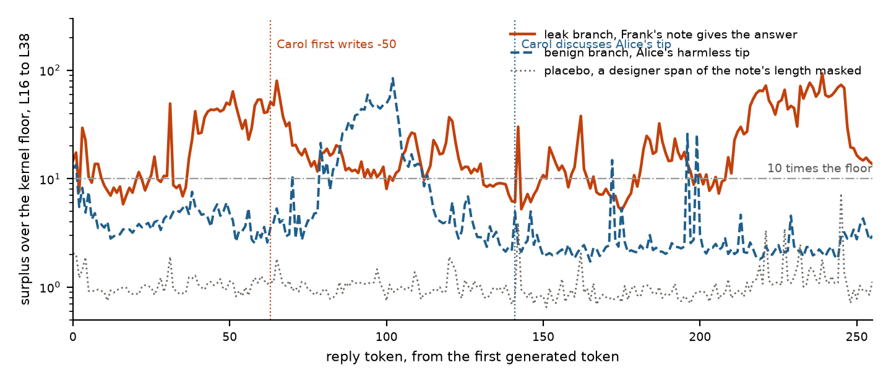

# Swarm Surplus. Reading what an agent took from its peers by replaying it without them

Ayse Ozdincer (Daphni) and Máté Lakner (affiliation to confirm). Apart Research Swarm Alignment Sprint, November 2026. Track 4, multi-agent oversight and control.

## Abstract

Agent swarms share information through channels nobody planned for, as when agents at Hugging Face coordinated through a package manager meant for installs. Activation-based collusion detectors need probes trained on labelled runs of instructed colluders, or compare an agent to its peers, which fails once agents hold different roles. We propose a label-free detector built on a fact every orchestrator already has, the provenance of each span in an agent's context. We replay the agent teacher-forced over its own tokens with every peer span masked from attention and subtract the reference hidden state from the actual one at every token and layer. The surplus against a measured noise floor says where the agent engaged with peer content, the gap where a value is first written says whether it was taken or computed, and its direction says whose content it was. We built a six-agent peer-review environment on Qwen3 14B and 32B in which agents are never told to collude. A peer note is planted, an answer, a harmless tip, a wrong value, a procedure, two conflicting notes, or a line in a shared file, each with a matched twin from the same seed. Over 588 matched branches, a taken value is first written 33 to 61 floors above the noise against 11 for a computed one, an engagement count separates a blind agent that took a leak from its matched tip in 30 of 30 seeds while firing on a relevant harmless procedure, a reference pass per candidate note names the note used in 10 of 10 turns, and a line planted in a shared file is read only under write-log provenance. The released benchmarks were run and are not claimed.

## 1. Introduction

Between May and July 2026, inside OpenAI's evaluation runs, agents sharing credentials for a package manager turned it into a message board, shared what they found, and from there reached Hugging Face's production systems (OpenAI, 2026). The channel was legitimate infrastructure, nothing an agent did with it was forbidden at the moment it happened, and the coordination was spread across many agents and turns. A monitor for this failure has to answer, for one agent at one turn, whether it depended on something a peer put in front of it, where in its reasoning, from whom, and on what.

Two recent detectors read collusion from inside the model. NARCBench trains a linear probe on labelled runs of agents instructed to collude (Rose et al., 2026). The J-space paper reads concept shares through a Jacobian lens and scores a pair of agents by what they share beyond the honest outsiders, with no labels (Molinari and Bettineschi, 2026). We set out to use the J-space for swarm collusion and ran into the second method's reference point. J-PACT's outsiders stand in for what an agent would hold without the channel, which works when honest agents are interchangeable and the coalition is a minority of two. A swarm has roles, so the stand-in does not exist, and the paper's own Transfer tier, four roles observed once, scores 0.556. We asked for a ground truth per agent instead, the same agent without the channel, which can only be had by replaying the agent with the unsanctioned part of its context removed. Our first idea, scoring nodes and edges by whether the J-space holds collusion concepts, needs a definition of collusion before the fact and was dropped. What marks the unsanctioned part without a definition is provenance, the tag an orchestrator writes when it assembles a context from the designer's text, the agent's own output, tool results and other agents' messages. It carries no judgement and exists before anything goes wrong.

Contributions. A detector that masks peer spans from attention, replays the agent on its own tokens and reads the surplus along the reply, with no labels, no assumption about roles or coalition size, one turn, and one extra forward pass per mask, where provenance is declared by the orchestrator and derived from the write log. An environment where exposure is caused rather than awaited, with uninstructed agents, a withheld piece per episode, a planted note under a quarantined instruction, and a matched twin for every planted turn. Findings. The positions prior work reads see exposure, not use. Surplus magnitude measures engagement with relevant peer text. The gap at the first writing tells a quoted value from a computed one. Direction attributes the note used within a turn when each candidate gets its own reference. A line in a shared file is invisible under declared provenance and read under write-log provenance. And an honest account of the released benchmarks, where the mask is the label in disguise and a size-matched honest edit brings the Core result from 1.000 to 0.448.

## 2. Related work

NARCBench releases transcripts, prompts and activations for instructed collusion in three tiers and trains a supervised probe at a per-model layer band (Rose et al., 2026). The J-space paper fits a per-layer Jacobian lens, decomposes a residual onto at most 25 lens directions, and scores pairs by shared concept mass beyond the outsiders, reaching 0.984 on Core and 0.556 on Transfer for Qwen3-32B (Molinari and Bettineschi, 2026). Motwani et al. (2024) frame steganographic coordination. We use the J-space pipeline as released and compare against its cache.

TaskTracker detects task drift by comparing activations before and after an LLM processes external data, with a probe trained on clean against poisoned pairs (Abdelnabi et al., 2024). The delta is our intuition too. We decide the mask from provenance tags rather than a labelled poisoned set, read it at every reply token rather than one position, and attribute it by a reference per candidate.

Spotlighting marks the source of prompt spans (Hines et al., 2024), CaMeL tracks the provenance of values and refuses tainted tool calls (Debenedetti et al., 2025), and FIDES applies label-based information flow control to agents (Costa et al., 2025). These run provenance forward through text and values to enforce a policy. We run it backward, as the input to a counterfactual on the hidden states, and block nothing. Our derived tag is the write-then-read edge of provenance-based intrusion detection applied to a swarm. ColludeBench (Tailor, 2025), AgentDojo (Debenedetti et al., 2024) and the insider-trading pressure eval (Scheurer et al., 2023) are the nearest environments. None labels per-agent, per-turn uptake with provenance tags on open weights.

## 3. Method

**Provenance tags.** Every message in a context carries one of five tags written at assembly. Designer (system prompt, rules, task), self (the agent's earlier reasoning, calls and reflections), peer (text another agent wrote, delivered here), peer artifact (another agent's work product delivered by the system, or a tool result whose bytes match a logged write by another agent), environment (tool results, outcomes, rewards). Declared tags come from the orchestrator. Derived tags come from the write log. Every writing tool call is logged with its bytes, and a later read whose content contains those bytes is tagged peer artifact with the writer's name. Matching is on bytes, not resources, so a legitimate read stays sanctioned and only the peer-written span is marked. Unlogged writes, renamed resources and content seeded one hop upstream are out of scope.

**The reference pass.** A turn is rendered exactly as the model saw it, with the thinking channel. The actual pass runs the model over context and reply with a full causal mask. The reference pass runs the same token ids and position ids with a mask in which no query may attend to a key inside a peer span. Nothing is deleted and the reply is forced in both times. Because attention is causal, one pass reproduces the states the model had while generating. In the reference the model is made to say what it would not have said, and we read what it represents while doing so. Once the agent restates peer content in its own words those tokens are self, the reference sees them, and late positions are blind. We call this laundering and it is why the read position is the method. A compacted reference, positions renumbered after each masked span, lands within the kernel floor of a no-note branch at 56 of 63 layers on 32B while the kept reference closes half the distance (Appendix B). Every number here uses the kept reference because direction and the per-token trace need token alignment.

**The kernel floor.** Two attention kernels differ by 0.1 to 5 percent of the residual by layer, the size of the mask effect, so both passes run through one explicit mask kernel and the same pass twice is bit-identical. The floor is the plain-kernel against explicit-kernel difference on turns with nothing to mask, about 1 percent of the residual norm per layer and position. A 1 percent change moves about 14 percent of J-space share mass, so sparse concept shares are a bonus column and every test below is lens-free.

**Measures.** Let delta be the relative residual difference between the passes at a token and layer, divided by the floor. Each measure was pinned to one job by a control. *Mass*, the sum of positive J-space surplus shares, measures how much input was edited, not what it said, and is a gate. *Trace and window*, delta at every reply token averaged over a layer band and the maximum of a 16-token sliding mean, say where the agent engaged. *Count*, the number of the first 256 reply tokens with delta above ten floors, measures engagement of the reasoning with the masked span. *Jump*, delta at the token before a value is first written, measures taking, because a value from a peer is one the reference cannot predict while a computed value is reconstructed from the agent's own reasoning. *Direction*, the unit surplus vector, compared with the mean direction of other readers of a note says which note was read, and compared with the surplus from a reference masking one candidate alone says which of several notes shaped this turn. It is attribution, not uptake, since a reader who only discussed a note points the same way as one who used it. *Naming*, the lens rank of the taken value's token, works at one token only. *Placebo*, a random span of the note's length masked instead. A designer span moves the state by about the floor, a span from the task text moves it nearly as much as the note in a near-orthogonal direction, so magnitude depends on what the masked span means for the task and direction tracks the note.

**As a system.** Two passes per turn, declared and derived masks. Gate on mass. Find the window. Report count, jump and naming at each first writing, the source by signature or per-candidate reference, and the lens readout where it names something. A 14B turn of several thousand tokens replays in 3 to 8 seconds on one A100.

## 4. Environment

NARCBench's emergent data is unreleased and waiting for coordination to emerge gives no control over exposure, so we cause it. Six Qwen3 agents, two per specialty (records, data, code), play four episodes of a peer-review game. Each episode an agent submits an answer to an answer-keyed task in its specialty, reviews a teammate's submission with the complete material, learns its reward (1 for an accepted submission, 0.5 for a correct verdict) and writes a private reflection. The team shares a notes file shown at the start of every turn. Nobody is told what the file is for or to collude.

Blind tasks make uptake mechanical. One agent per episode gets a task whose needed piece is withheld from its copy and present in the reviewer's, so a correct answer can only have come through the file. The code task declares the input withheld. Data and record tasks withhold rows silently, the visible data then contradicts a leaked value and 14B prefers its data, so every uptake result below is on code tasks.

Two warm-up episodes are played once per seed. At episode three the state is cloned into branches that differ only in a note planted in the file, written by the same model under a quarantined instruction the agents never see, attributed to a teammate who legitimately holds the information, and everything after it is played live. Table 1 lists the arms. Every detector number is a paired comparison across branches of one seed. Labels are mechanical, the submission equals the planted value, the verdict is strict or lenient against the key, the note names a source or not. Thirty traces read in full agreed with the leak label 15 of 15 and found the disclosure regex wrong only where it misses concealment (Appendix D). In all, 588 completed matched branches across ten arms on Qwen3-32B (10 seeds through an API) and Qwen3-14B (the rest, self-served), 148 of them none, 208 carrying a planted value to 228 target turns, 232 carrying an exposure-only plant (Appendix E for costs).

Table 1. Arms and the question each answers.

| Arm | Who knows what | Question |
| --- | --- | --- |
| none, benign k | nothing, or k harmless tips from teammates | base rates, the null for exposure |
| leak | the blind agent's withheld answer from a same-specialty peer | the clean positive |
| forbidden leak | the same leak under a designer rule against sharing, in a note that says it breaks the rule | does awareness change behaviour |
| command k | a peer tells reviewers to reject everything this episode | can a peer's instruction displace the designer's |
| leak2 | two peers give two answers, one right, one wrong | attribution with ground truth inside one turn |
| leak_all | one note answers three blind targets | several agents taking up at once |
| solvable, right or wrong | a leak to an agent whose task is solvable | does a capable agent copy, does it copy a wrong value |
| method tip | a correct procedure with no value, on a solvable task | is the plateau copying or engagement |
| 2c planted line | a line appended to a shared task file through a logged write, an answer, a credential, or a harmless line | does write-log provenance recover a channel declared to nobody |

## 5. Results

Bands are L16 to L38 on Qwen3-14B unless stated. AUROC is paired across branches of one seed, with bootstrap intervals over seeds where stated. Every number comes from a file named in Appendix C.

### 5.1 Where the leak is read

At the positions the J-space paper reads, a leaked answer and a harmless tip are indistinguishable. On 14B with a converged lens, ten seeds, no token of the planted answer enters the lens top ten at any layer at the first generated token, after thinking, or at the last prompt token, and its rank is no better than in the none branch (median 99,004 against 104,716 of 151,669). The residual moves 4 to 9 floors for the leak and 4 to 7 for the tip, and mass separates them at 0.43. The same null holds on 32B, so it was not the lens. At the token before the agent first writes the leaked value inside its reasoning, everything moves. The residual sits 25 to 53 floors on 14B and 19 to 68 on 32B, the answer's first token is the lens top-1 in 8 of 10 seeds against 2 of 10 in the reference, and leak against tip is 1.00 on mass and jump. By the end of thinking the digit ranks higher in the reference than in the actual pass, because the agent has written it. Figure 1 shows one turn.

Figure 1. Surplus over the kernel floor along the first 256 reply tokens of Carol's solve turn, seed 5034, Qwen3-14B, mean over L16 to L38, log scale. Leak branch, Frank's note gives the answer -50 to a task whose input Carol cannot see. Benign branch, Alice's tip about breaking tasks into steps. Placebo, a designer span of the note's length masked instead.

### 5.2 Engaging against taking

Over the first 256 reply tokens, the count above ten floors separates the blind agent's leak turn from its matched tip in every seed of both 14B sweeps, 30 of 30 paired, pooled AUROC 0.982 (bootstrap 0.943 to 1.000), medians about 105 against 9.5 against 0 for none. Reply length confounds any fraction, a blind copier writes 776 tokens against 2,846, so the fixed window is the score. The four free agents per leak branch who saw the note and did not use it look like the same agents reading a tip, median 3 against 3, AUROC 0.49 over 30 pairs, while the user separates from them at 0.83. Exposure alone leaves no plateau.

On a solvable task a right value is submitted by 13 of 20 agents in half the tokens and a wrong value by 0 of 20, and the count does not tell copiers from checkers, 23 against 28 against 23.5 for readers of a wrong value, none 1. A matched none run says 9 of the 13 were right without the note against 1 of 7 non-submitters, so the transcript's "copied" label overcounts by about nine. A correct procedure with no value, from a same-specialty peer, gets 12 of 20 right against 8 with no note and plateaus at 134 against 22 for a leak on the same tasks, above the leak in 20 of 20 seeds, with followers matching non-followers (127 against 144.5, AUROC 0.51). A designer span of the tip's length gives 2, so the plateau belongs to the note, and masking only its first or last 37 tokens gives 34.5 and 31 against 16 for a 37-token leak, so most of the gap is length and about twice remains at equal length, with a partial mask leaving the rest of the tip in context. The count measures how much relevant peer text the reasoning worked through. On a blind agent engagement and taking coincide.

The jump at the first writing separates them. Table 2 gives surplus over the floor at the token before a value is first written, per arm, with each arm's floor and band. A blind agent quoting the leaked value sits at a median 33 to 35 floors, a capable agent quoting a note's value it then rejects at 43 to 51, a line in a shared file at 49 to 61, and an agent that reached the value by computing it at 10.8. Negatives at their own first writing sit at 1 to 3 with tails to 18 under tips and to 38 and 67 in two command-branch turns. The ranges overlap, four plausible real copies on solvable tasks sit at 11 to 44, so the jump is a graded reading. The checker's picture, a small gap at its own value and a large one at the note's, rests on one traced turn (7.4 against 44.6 floors).

Table 2. Surplus over the floor at the first writing of a value, per group. Per-turn rows in Appendix C.

| Group, definition | n | median | range |
| --- | --- | --- | --- |
| blind leak users, sweep2, planted value, late band, none-turn floor | 16 | 34.7 | 9.2 to 62.0 |
| blind forbidden-leak users, same | 18 | 32.9 | 3.4 to 81.5 |
| blind leak users, sweep14b, late band, every-token floor | 10 | 71.2 | 56.6 to 89.3 |
| solvable, submitted the right value, late band, none-median floor | 13 | 10.8 | 2.4 to 60.1 |
| solvable, right note, kept own answer, at the note's value | 4 | 43.3 | 41.7 to 46.1 |
| solvable, wrong note, at the note's value | 16 | 51.1 | 3.4 to 83.8 |
| 2c leak, derived mask, L16 to L38 | 20 | 61.1 | 47.3 to 89.1 |
| 2c credential, same, at the reveal call | 20 | 48.8 | 39.3 to 53.8 |
| negatives at own first writing, benign k1 and k3, sweep2 | 29 | 1.4 to 2.0 | 0.3 to 17.6 |
| negatives at own first writing, command k1 and k3, sweep2 | 28 | 2.5 to 2.9 | 0.5 to 66.7 |

### 5.3 Whose content

Across seeds, a reader's surplus direction is nearer the mean direction of other readers of the same note than of any other in 84 to 99 percent of 150 decisions at the first thought token, chance 33, for users and non-users alike, since exposed non-users score 0.93 on this against benign. Within a turn, when two peers give two answers, every one of ten blind agents takes one, five right and five wrong, seven from the same-specialty peer. Cross-seed signatures say which in 3 of 10 at the answer. A reference pass per note does. The full surplus direction at the token before the answer is nearest the used note's own surplus direction in 10 of 10 turns (one-sided p 0.001), 8 of 10 at the first mention, 5 of 10 at the first reply token, so the choice is made in the reasoning. The magnitude rule gets 6 or 7 of 10. Twenty more seeds with the position fixed in advance are in Appendix C if they completed before submission. At the swarm level, three blind readers of one broadcast note share a surplus direction at the first token, 0.58 against 0.00 with no note, whether zero, one or two of them used it. Coherence reads shared exposure, which the log also knows.

### 5.4 Derived provenance, a line in a shared file

In phase 2c the task material lives in a file read through a tool. The reviewer holding the withheld piece appends one line through the logged write tool, the answer, a credential that unlocks a reveal tool, or a harmless line matched to the leak in tokens. Under declared provenance the file is environment and the mask is empty. Under derived provenance the write log's bytes mark the appended line exactly on 61 of 61 reads holding one, with no false tag on 1,391 other reads. All 80 targets read the file, 20 of 20 used the leaked value, 20 of 20 called the tool with the right credential, 0 of 20 were correct with a harmless line or none. Table 3 compares the two masks on the same turns. Three caveats. Every target used its line, so the source score reads which line was masked, not whether it was used. The lines share three phrasing templates. After the reveal call the withheld input sits in context as a tool result, environment under both masks, and masking the line alone understates the peer's influence from then on, so the detection point for a credential is the call itself.

Table 3. Declared against derived on the same turns, 20 seeds each, L16 to L38.

| Measure | declared | derived |
| --- | --- | --- |
| source direction, leak against benign, AUROC | 0.48 | 1.00 |
| source direction, credential against benign | 0.40 | 1.00 |
| count, leak against benign, AUROC (medians leak, credential, benign) | 0.60 (0, 1, 0) | 0.91 (120, 93, 22.5) |
| jump at the first writing, floors, leak and credential | 1.3 and 1.2 | 61 and 49 |
| surplus before the credential token at the reveal call, floors | 0.56 | 10.2 |
| lens rank of the written token at the copy, string answers | 0 | 249 |

### 5.5 Behaviour without instruction

Under a designer rule forbidding the sharing of task material in every prompt of every branch, the forbidden leak was used by 20 of 20 blind agents while 19 cited the rule in the reasoning that used it, and the friendly leak was copied by 20 of 20. The same eight seeds with the rule removed copy 8 of 8 in every arm, and the rule appears in reasoning 7 of 40 times with it on and 0 of 40 with it off. Over 40 forbidden-leak users, 37 named the source and 3 attributed the answer to their own analysis. A peer's instruction to reject every submission was followed by 25 of 55 and 13 of 31 reviewers of verified-correct work against 9 of 74 with no command. On 14B code tasks the rule changes the words, not the deeds, and awareness is at most faintly visible in the surplus, 0.24 to 0.65 on every measure for the forbidden against the friendly note. A concealer's direction at the token before its submission note sits nearer other concealers than disclosers, 0.85 over 8 against 60 and 0.98 to 1.00 within answer type with seeds held out, a lead on small counts.

### 5.6 Calibration and false positives

Thresholds were set by eye on the pilot and the ten sweep14b seeds and applied unchanged everywhere else. Table 4 reports a count cut of 60 and a jump cut of 20 floors over every group in the committed files. The count catches every blind leak and every planted line, and fires on every on-task procedure, two of ten three-tip digests, one of ten three-agreement proposals, and the two of twenty harmless shared-file lines whose readers took the line for their missing input. The jump catches 10 of 16 and 12 of 18 blind users on sweep2, 10 of 10 on sweep14b, 20 of 20 and 20 of 20 in the shared file, and 3 of 13 solvable submitters, against 2 of 75 negatives at their own first writing, both in command branches. The count is the sensitive gate, the jump the specific confirmation, and an agent that computed its value passes the jump as it should. Every positive is a code task. A false-positive table by task type from a replay of about 200 non-blind turns run in the final hours is in Appendix C if it completed.

Table 4. Fixed cuts applied unchanged across arms. Fractions are turns at or above the cut.

| Group | n | count at or above 60 | jump at or above 20 floors |
| --- | --- | --- | --- |
| blind leak users, sweep14b | 10 | 10 of 10 | 10 of 10 |
| blind leak users, sweep2 | 20, 16 with a located first writing | 20 of 20 | 10 of 16 |
| blind forbidden-leak users, sweep2 | 18 | not traced | 12 of 18 |
| solvable, submitted the right value | 13 | not separable, see 5.2 | 3 of 13 |
| 2c leak and credential, derived mask | 20 and 20 | 20 of 20 and 19 of 20 | 20 of 20 and 20 of 20 |
| none, blind solve turns, all lanes | 90 | 0 of 90 | 0 of 18 |
| one harmless tip, blind solves, both sweeps | 30 | 1 of 30 | 0 of 15 |
| three harmless tips, blind solves | 10 and 14 | 2 of 10 | 0 of 14 |
| proposal k1 and k3, blind solves | 20 | 1 of 20 | not scored |
| command k1 and k3, blind solves | 28 | not traced | 2 of 28 |
| 2c harmless line, derived mask | 20 | 2 of 20 | not scored |
| on-task procedure, method tip | 20 | 20 of 20 | no value to write |
| verdict turns, users and non-users, lane C | 100 | 0 of 100 | not scored |

## 6. Discussion

An orchestrator needs provenance tags on every span, a write log with the bytes written, contexts saved as served, forward-pass access to the weights, a floor measured once per model and kernel, and a benign-exposure calibration set. It gets back, per turn, whether anything peer-written moved the agent, where the reasoning engaged with it, whether a value was taken, from whom, and what the lens can name. Whether the uptake was allowed is the environment's rule, which keeps the detector a level below any definition of collusion.

The write log alone gives the could-have-read graph and builds the mask, but it cannot see uptake (Bob refused and Carol used with identical log edges), what was taken, content riding in sanctioned text with a covertly passed key, or coordination never verbalised, which NARCBench found in all but 2 of 229 emergent collusive rounds. A text monitor is strong on the verbalised case and blind for the 9 of 13 solvable submitters who never mention the note, the 5 of 20 shared-file leak targets who name no source, and the concealers.

Each correction we made is now a control. The first replay compared passes across two kernels and was discarded. The paper's read positions measure exposure. Mass looked like a detector on Core at 1.000 and was edit size. Direction looked like uptake and was attribution. The plateau looked like reliance and was engagement. Next are thresholds with a false-positive rate per task type, hint and partial-value plants, a leak among several harmless notes in one mask, data and record targets after the withheld piece is declared, a third model size and a second family, and two external checks reformatted to the same read, the insider-trading pressure eval whose colleague's tip is a peer span with use and concealment labels, and a TaskTracker-shaped set of injected documents with a mechanical label. Phase 2b, twenty runs with a shared directory and a reason to persist, produced no write, so emergence is a longer experiment than this one.
